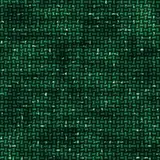
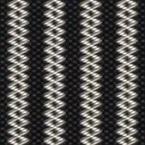

<!-- AUTO-GENERATED by tools/build_board.py — DO NOT HAND-EDIT -->

# Library Management Board

Visual index of **3** pack(s) (**439** assets total). Generated from [`packs.json`](../packs.json) and committed [`thumbs/`](../thumbs).

| Cover | Pack | Files | Size | Links |
| :---: | :--- | :---: | :---: | :--- |
|  | **[Cloth Textures Vol. 1](cloth-textures-vol1.md)** 164 seamless 512x512 woven cloth and fabric textures. | 164 | 46.8 MB | [Grid](cloth-textures-vol1.md) · [Shelf (`shelf-cloth-textures-vol1`)](https://github.com/Artbyo3/DEVIL-PAINTER_Asset_Library/releases/tag/shelf-cloth-textures-vol1) · [Public](https://github.com/Artbyo3/DEVIL-PAINTER_Asset_Library/releases/tag/cloth-textures-vol1-v1.0.0) |
|  | **[Cloth Textures Vol. 2](cloth-textures-vol2.md)** 160 seamless 512x512 knit, quilted, and patterned fabric textures. | 160 | 70.4 MB | [Grid](cloth-textures-vol2.md) · [Shelf (`shelf-cloth-textures-vol2`)](https://github.com/Artbyo3/DEVIL-PAINTER_Asset_Library/releases/tag/shelf-cloth-textures-vol2) · [Public](https://github.com/Artbyo3/DEVIL-PAINTER_Asset_Library/releases/tag/cloth-textures-vol2-v1.0.0) |
|  | **[Alphas Vol. 1](alphas-vol1.md)** 115 sculpting, stitch, seam, trim, fastener, and grunge height alphas. | 115 | 2.8 MB | [Grid](alphas-vol1.md) · [Shelf (`shelf-alphas-vol1`)](https://github.com/Artbyo3/DEVIL-PAINTER_Asset_Library/releases/tag/shelf-alphas-vol1) · [Public](https://github.com/Artbyo3/DEVIL-PAINTER_Asset_Library/releases/tag/alphas-vol1-v1.0.0) |
