<!-- AUTO-GENERATED by tools/build_board.py — DO NOT HAND-EDIT -->

# Cloth Textures Vol. 1

[All Packs](README.md) · [Shelf Draft (`shelf-cloth-textures-vol1`)](https://github.com/Artbyo3/DEVIL-PAINTER_Asset_Library/releases/tag/shelf-cloth-textures-vol1) · [Public Release (`cloth-textures-vol1-v1.0.0`)](https://github.com/Artbyo3/DEVIL-PAINTER_Asset_Library/releases/tag/cloth-textures-vol1-v1.0.0) · [Download Zip](https://github.com/Artbyo3/DEVIL-PAINTER_Asset_Library/releases/download/cloth-textures-vol1-v1.0.0/Cloth_Textures_Vol1.zip)

164 seamless 512x512 woven cloth and fabric textures.

**Files:** 164 · **Zip Size:** 46.8 MB · **Tags:** `cloth`, `fabric`, `textile`, `apparel`, `weave`, `boucle`, `corduroy`, `denim`, `herringbone`, `houndstooth`, `jacquard`, `silk`, `plaid`

| Asset 1 | Asset 2 | Asset 3 | Asset 4 |
| :---: | :---: | :---: | :---: |
| [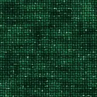](https://github.com/Artbyo3/DEVIL-PAINTER_Asset_Library/releases/tag/shelf-cloth-textures-vol1) `boucle-tweed-01.png` [Shelf](https://github.com/Artbyo3/DEVIL-PAINTER_Asset_Library/releases/tag/shelf-cloth-textures-vol1) · [Public](https://github.com/Artbyo3/DEVIL-PAINTER_Asset_Library/releases/download/cloth-textures-vol1-v1.0.0/boucle-tweed-01.png) | [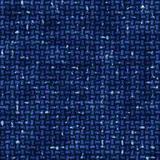](https://github.com/Artbyo3/DEVIL-PAINTER_Asset_Library/releases/tag/shelf-cloth-textures-vol1) `boucle-tweed-02.png` [Shelf](https://github.com/Artbyo3/DEVIL-PAINTER_Asset_Library/releases/tag/shelf-cloth-textures-vol1) · [Public](https://github.com/Artbyo3/DEVIL-PAINTER_Asset_Library/releases/download/cloth-textures-vol1-v1.0.0/boucle-tweed-02.png) | [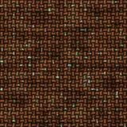](https://github.com/Artbyo3/DEVIL-PAINTER_Asset_Library/releases/tag/shelf-cloth-textures-vol1) `boucle-tweed-03.png` [Shelf](https://github.com/Artbyo3/DEVIL-PAINTER_Asset_Library/releases/tag/shelf-cloth-textures-vol1) · [Public](https://github.com/Artbyo3/DEVIL-PAINTER_Asset_Library/releases/download/cloth-textures-vol1-v1.0.0/boucle-tweed-03.png) | [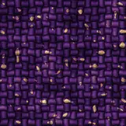](https://github.com/Artbyo3/DEVIL-PAINTER_Asset_Library/releases/tag/shelf-cloth-textures-vol1) `boucle-tweed-04.png` [Shelf](https://github.com/Artbyo3/DEVIL-PAINTER_Asset_Library/releases/tag/shelf-cloth-textures-vol1) · [Public](https://github.com/Artbyo3/DEVIL-PAINTER_Asset_Library/releases/download/cloth-textures-vol1-v1.0.0/boucle-tweed-04.png) |
| [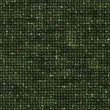](https://github.com/Artbyo3/DEVIL-PAINTER_Asset_Library/releases/tag/shelf-cloth-textures-vol1) `boucle-tweed-05.png` [Shelf](https://github.com/Artbyo3/DEVIL-PAINTER_Asset_Library/releases/tag/shelf-cloth-textures-vol1) · [Public](https://github.com/Artbyo3/DEVIL-PAINTER_Asset_Library/releases/download/cloth-textures-vol1-v1.0.0/boucle-tweed-05.png) | [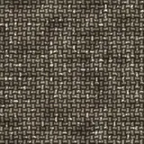](https://github.com/Artbyo3/DEVIL-PAINTER_Asset_Library/releases/tag/shelf-cloth-textures-vol1) `boucle-tweed-06.png` [Shelf](https://github.com/Artbyo3/DEVIL-PAINTER_Asset_Library/releases/tag/shelf-cloth-textures-vol1) · [Public](https://github.com/Artbyo3/DEVIL-PAINTER_Asset_Library/releases/download/cloth-textures-vol1-v1.0.0/boucle-tweed-06.png) | [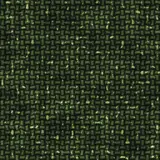](https://github.com/Artbyo3/DEVIL-PAINTER_Asset_Library/releases/tag/shelf-cloth-textures-vol1) `boucle-tweed-07.png` [Shelf](https://github.com/Artbyo3/DEVIL-PAINTER_Asset_Library/releases/tag/shelf-cloth-textures-vol1) · [Public](https://github.com/Artbyo3/DEVIL-PAINTER_Asset_Library/releases/download/cloth-textures-vol1-v1.0.0/boucle-tweed-07.png) | [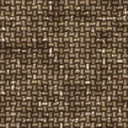](https://github.com/Artbyo3/DEVIL-PAINTER_Asset_Library/releases/tag/shelf-cloth-textures-vol1) `boucle-tweed-08.png` [Shelf](https://github.com/Artbyo3/DEVIL-PAINTER_Asset_Library/releases/tag/shelf-cloth-textures-vol1) · [Public](https://github.com/Artbyo3/DEVIL-PAINTER_Asset_Library/releases/download/cloth-textures-vol1-v1.0.0/boucle-tweed-08.png) |
| [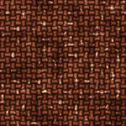](https://github.com/Artbyo3/DEVIL-PAINTER_Asset_Library/releases/tag/shelf-cloth-textures-vol1) `boucle-tweed-09.png` [Shelf](https://github.com/Artbyo3/DEVIL-PAINTER_Asset_Library/releases/tag/shelf-cloth-textures-vol1) · [Public](https://github.com/Artbyo3/DEVIL-PAINTER_Asset_Library/releases/download/cloth-textures-vol1-v1.0.0/boucle-tweed-09.png) | [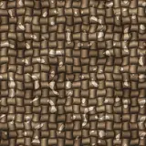](https://github.com/Artbyo3/DEVIL-PAINTER_Asset_Library/releases/tag/shelf-cloth-textures-vol1) `boucle-tweed-10.png` [Shelf](https://github.com/Artbyo3/DEVIL-PAINTER_Asset_Library/releases/tag/shelf-cloth-textures-vol1) · [Public](https://github.com/Artbyo3/DEVIL-PAINTER_Asset_Library/releases/download/cloth-textures-vol1-v1.0.0/boucle-tweed-10.png) | [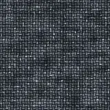](https://github.com/Artbyo3/DEVIL-PAINTER_Asset_Library/releases/tag/shelf-cloth-textures-vol1) `boucle-tweed-11.png` [Shelf](https://github.com/Artbyo3/DEVIL-PAINTER_Asset_Library/releases/tag/shelf-cloth-textures-vol1) · [Public](https://github.com/Artbyo3/DEVIL-PAINTER_Asset_Library/releases/download/cloth-textures-vol1-v1.0.0/boucle-tweed-11.png) | [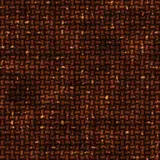](https://github.com/Artbyo3/DEVIL-PAINTER_Asset_Library/releases/tag/shelf-cloth-textures-vol1) `boucle-tweed-12.png` [Shelf](https://github.com/Artbyo3/DEVIL-PAINTER_Asset_Library/releases/tag/shelf-cloth-textures-vol1) · [Public](https://github.com/Artbyo3/DEVIL-PAINTER_Asset_Library/releases/download/cloth-textures-vol1-v1.0.0/boucle-tweed-12.png) |
| [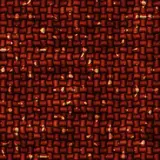](https://github.com/Artbyo3/DEVIL-PAINTER_Asset_Library/releases/tag/shelf-cloth-textures-vol1) `boucle-tweed-13.png` [Shelf](https://github.com/Artbyo3/DEVIL-PAINTER_Asset_Library/releases/tag/shelf-cloth-textures-vol1) · [Public](https://github.com/Artbyo3/DEVIL-PAINTER_Asset_Library/releases/download/cloth-textures-vol1-v1.0.0/boucle-tweed-13.png) | [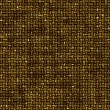](https://github.com/Artbyo3/DEVIL-PAINTER_Asset_Library/releases/tag/shelf-cloth-textures-vol1) `boucle-tweed-14.png` [Shelf](https://github.com/Artbyo3/DEVIL-PAINTER_Asset_Library/releases/tag/shelf-cloth-textures-vol1) · [Public](https://github.com/Artbyo3/DEVIL-PAINTER_Asset_Library/releases/download/cloth-textures-vol1-v1.0.0/boucle-tweed-14.png) | [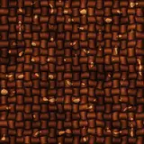](https://github.com/Artbyo3/DEVIL-PAINTER_Asset_Library/releases/tag/shelf-cloth-textures-vol1) `boucle-tweed-15.png` [Shelf](https://github.com/Artbyo3/DEVIL-PAINTER_Asset_Library/releases/tag/shelf-cloth-textures-vol1) · [Public](https://github.com/Artbyo3/DEVIL-PAINTER_Asset_Library/releases/download/cloth-textures-vol1-v1.0.0/boucle-tweed-15.png) | [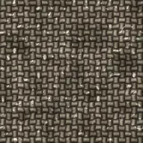](https://github.com/Artbyo3/DEVIL-PAINTER_Asset_Library/releases/tag/shelf-cloth-textures-vol1) `boucle-tweed-16.png` [Shelf](https://github.com/Artbyo3/DEVIL-PAINTER_Asset_Library/releases/tag/shelf-cloth-textures-vol1) · [Public](https://github.com/Artbyo3/DEVIL-PAINTER_Asset_Library/releases/download/cloth-textures-vol1-v1.0.0/boucle-tweed-16.png) |
| [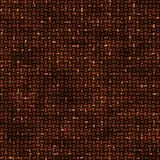](https://github.com/Artbyo3/DEVIL-PAINTER_Asset_Library/releases/tag/shelf-cloth-textures-vol1) `boucle-tweed-17.png` [Shelf](https://github.com/Artbyo3/DEVIL-PAINTER_Asset_Library/releases/tag/shelf-cloth-textures-vol1) · [Public](https://github.com/Artbyo3/DEVIL-PAINTER_Asset_Library/releases/download/cloth-textures-vol1-v1.0.0/boucle-tweed-17.png) | [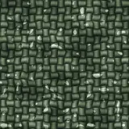](https://github.com/Artbyo3/DEVIL-PAINTER_Asset_Library/releases/tag/shelf-cloth-textures-vol1) `boucle-tweed-18.png` [Shelf](https://github.com/Artbyo3/DEVIL-PAINTER_Asset_Library/releases/tag/shelf-cloth-textures-vol1) · [Public](https://github.com/Artbyo3/DEVIL-PAINTER_Asset_Library/releases/download/cloth-textures-vol1-v1.0.0/boucle-tweed-18.png) | [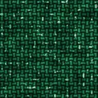](https://github.com/Artbyo3/DEVIL-PAINTER_Asset_Library/releases/tag/shelf-cloth-textures-vol1) `boucle-tweed-19.png` [Shelf](https://github.com/Artbyo3/DEVIL-PAINTER_Asset_Library/releases/tag/shelf-cloth-textures-vol1) · [Public](https://github.com/Artbyo3/DEVIL-PAINTER_Asset_Library/releases/download/cloth-textures-vol1-v1.0.0/boucle-tweed-19.png) | [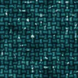](https://github.com/Artbyo3/DEVIL-PAINTER_Asset_Library/releases/tag/shelf-cloth-textures-vol1) `boucle-tweed-20.png` [Shelf](https://github.com/Artbyo3/DEVIL-PAINTER_Asset_Library/releases/tag/shelf-cloth-textures-vol1) · [Public](https://github.com/Artbyo3/DEVIL-PAINTER_Asset_Library/releases/download/cloth-textures-vol1-v1.0.0/boucle-tweed-20.png) |
| [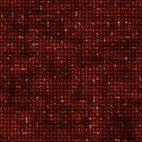](https://github.com/Artbyo3/DEVIL-PAINTER_Asset_Library/releases/tag/shelf-cloth-textures-vol1) `boucle-tweed-21.png` [Shelf](https://github.com/Artbyo3/DEVIL-PAINTER_Asset_Library/releases/tag/shelf-cloth-textures-vol1) · [Public](https://github.com/Artbyo3/DEVIL-PAINTER_Asset_Library/releases/download/cloth-textures-vol1-v1.0.0/boucle-tweed-21.png) | [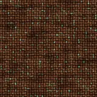](https://github.com/Artbyo3/DEVIL-PAINTER_Asset_Library/releases/tag/shelf-cloth-textures-vol1) `boucle-tweed-22.png` [Shelf](https://github.com/Artbyo3/DEVIL-PAINTER_Asset_Library/releases/tag/shelf-cloth-textures-vol1) · [Public](https://github.com/Artbyo3/DEVIL-PAINTER_Asset_Library/releases/download/cloth-textures-vol1-v1.0.0/boucle-tweed-22.png) | [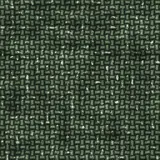](https://github.com/Artbyo3/DEVIL-PAINTER_Asset_Library/releases/tag/shelf-cloth-textures-vol1) `boucle-tweed-23.png` [Shelf](https://github.com/Artbyo3/DEVIL-PAINTER_Asset_Library/releases/tag/shelf-cloth-textures-vol1) · [Public](https://github.com/Artbyo3/DEVIL-PAINTER_Asset_Library/releases/download/cloth-textures-vol1-v1.0.0/boucle-tweed-23.png) | [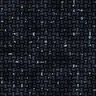](https://github.com/Artbyo3/DEVIL-PAINTER_Asset_Library/releases/tag/shelf-cloth-textures-vol1) `boucle-tweed-24.png` [Shelf](https://github.com/Artbyo3/DEVIL-PAINTER_Asset_Library/releases/tag/shelf-cloth-textures-vol1) · [Public](https://github.com/Artbyo3/DEVIL-PAINTER_Asset_Library/releases/download/cloth-textures-vol1-v1.0.0/boucle-tweed-24.png) |
| [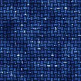](https://github.com/Artbyo3/DEVIL-PAINTER_Asset_Library/releases/tag/shelf-cloth-textures-vol1) `boucle-tweed-25.png` [Shelf](https://github.com/Artbyo3/DEVIL-PAINTER_Asset_Library/releases/tag/shelf-cloth-textures-vol1) · [Public](https://github.com/Artbyo3/DEVIL-PAINTER_Asset_Library/releases/download/cloth-textures-vol1-v1.0.0/boucle-tweed-25.png) | [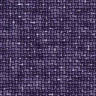](https://github.com/Artbyo3/DEVIL-PAINTER_Asset_Library/releases/tag/shelf-cloth-textures-vol1) `boucle-tweed-26.png` [Shelf](https://github.com/Artbyo3/DEVIL-PAINTER_Asset_Library/releases/tag/shelf-cloth-textures-vol1) · [Public](https://github.com/Artbyo3/DEVIL-PAINTER_Asset_Library/releases/download/cloth-textures-vol1-v1.0.0/boucle-tweed-26.png) | [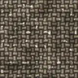](https://github.com/Artbyo3/DEVIL-PAINTER_Asset_Library/releases/tag/shelf-cloth-textures-vol1) `boucle-tweed-27.png` [Shelf](https://github.com/Artbyo3/DEVIL-PAINTER_Asset_Library/releases/tag/shelf-cloth-textures-vol1) · [Public](https://github.com/Artbyo3/DEVIL-PAINTER_Asset_Library/releases/download/cloth-textures-vol1-v1.0.0/boucle-tweed-27.png) | [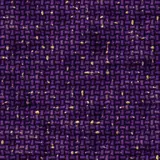](https://github.com/Artbyo3/DEVIL-PAINTER_Asset_Library/releases/tag/shelf-cloth-textures-vol1) `boucle-tweed-28.png` [Shelf](https://github.com/Artbyo3/DEVIL-PAINTER_Asset_Library/releases/tag/shelf-cloth-textures-vol1) · [Public](https://github.com/Artbyo3/DEVIL-PAINTER_Asset_Library/releases/download/cloth-textures-vol1-v1.0.0/boucle-tweed-28.png) |
| [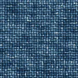](https://github.com/Artbyo3/DEVIL-PAINTER_Asset_Library/releases/tag/shelf-cloth-textures-vol1) `boucle-tweed-29.png` [Shelf](https://github.com/Artbyo3/DEVIL-PAINTER_Asset_Library/releases/tag/shelf-cloth-textures-vol1) · [Public](https://github.com/Artbyo3/DEVIL-PAINTER_Asset_Library/releases/download/cloth-textures-vol1-v1.0.0/boucle-tweed-29.png) | [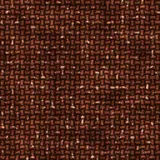](https://github.com/Artbyo3/DEVIL-PAINTER_Asset_Library/releases/tag/shelf-cloth-textures-vol1) `boucle-tweed-30.png` [Shelf](https://github.com/Artbyo3/DEVIL-PAINTER_Asset_Library/releases/tag/shelf-cloth-textures-vol1) · [Public](https://github.com/Artbyo3/DEVIL-PAINTER_Asset_Library/releases/download/cloth-textures-vol1-v1.0.0/boucle-tweed-30.png) | [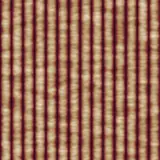](https://github.com/Artbyo3/DEVIL-PAINTER_Asset_Library/releases/tag/shelf-cloth-textures-vol1) `corduroy-01.png` [Shelf](https://github.com/Artbyo3/DEVIL-PAINTER_Asset_Library/releases/tag/shelf-cloth-textures-vol1) · [Public](https://github.com/Artbyo3/DEVIL-PAINTER_Asset_Library/releases/download/cloth-textures-vol1-v1.0.0/corduroy-01.png) | [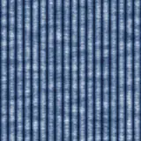](https://github.com/Artbyo3/DEVIL-PAINTER_Asset_Library/releases/tag/shelf-cloth-textures-vol1) `corduroy-02.png` [Shelf](https://github.com/Artbyo3/DEVIL-PAINTER_Asset_Library/releases/tag/shelf-cloth-textures-vol1) · [Public](https://github.com/Artbyo3/DEVIL-PAINTER_Asset_Library/releases/download/cloth-textures-vol1-v1.0.0/corduroy-02.png) |
| [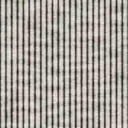](https://github.com/Artbyo3/DEVIL-PAINTER_Asset_Library/releases/tag/shelf-cloth-textures-vol1) `corduroy-03.png` [Shelf](https://github.com/Artbyo3/DEVIL-PAINTER_Asset_Library/releases/tag/shelf-cloth-textures-vol1) · [Public](https://github.com/Artbyo3/DEVIL-PAINTER_Asset_Library/releases/download/cloth-textures-vol1-v1.0.0/corduroy-03.png) | [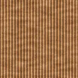](https://github.com/Artbyo3/DEVIL-PAINTER_Asset_Library/releases/tag/shelf-cloth-textures-vol1) `corduroy-04.png` [Shelf](https://github.com/Artbyo3/DEVIL-PAINTER_Asset_Library/releases/tag/shelf-cloth-textures-vol1) · [Public](https://github.com/Artbyo3/DEVIL-PAINTER_Asset_Library/releases/download/cloth-textures-vol1-v1.0.0/corduroy-04.png) | [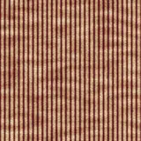](https://github.com/Artbyo3/DEVIL-PAINTER_Asset_Library/releases/tag/shelf-cloth-textures-vol1) `corduroy-05.png` [Shelf](https://github.com/Artbyo3/DEVIL-PAINTER_Asset_Library/releases/tag/shelf-cloth-textures-vol1) · [Public](https://github.com/Artbyo3/DEVIL-PAINTER_Asset_Library/releases/download/cloth-textures-vol1-v1.0.0/corduroy-05.png) |  `corduroy-06.png` [Shelf](https://github.com/Artbyo3/DEVIL-PAINTER_Asset_Library/releases/tag/shelf-cloth-textures-vol1) · [Public](https://github.com/Artbyo3/DEVIL-PAINTER_Asset_Library/releases/download/cloth-textures-vol1-v1.0.0/corduroy-06.png) |
| [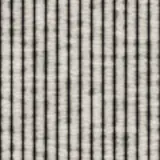](https://github.com/Artbyo3/DEVIL-PAINTER_Asset_Library/releases/tag/shelf-cloth-textures-vol1) `corduroy-07.png` [Shelf](https://github.com/Artbyo3/DEVIL-PAINTER_Asset_Library/releases/tag/shelf-cloth-textures-vol1) · [Public](https://github.com/Artbyo3/DEVIL-PAINTER_Asset_Library/releases/download/cloth-textures-vol1-v1.0.0/corduroy-07.png) | [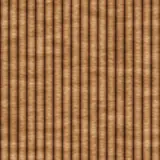](https://github.com/Artbyo3/DEVIL-PAINTER_Asset_Library/releases/tag/shelf-cloth-textures-vol1) `corduroy-08.png` [Shelf](https://github.com/Artbyo3/DEVIL-PAINTER_Asset_Library/releases/tag/shelf-cloth-textures-vol1) · [Public](https://github.com/Artbyo3/DEVIL-PAINTER_Asset_Library/releases/download/cloth-textures-vol1-v1.0.0/corduroy-08.png) | [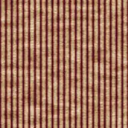](https://github.com/Artbyo3/DEVIL-PAINTER_Asset_Library/releases/tag/shelf-cloth-textures-vol1) `corduroy-09.png` [Shelf](https://github.com/Artbyo3/DEVIL-PAINTER_Asset_Library/releases/tag/shelf-cloth-textures-vol1) · [Public](https://github.com/Artbyo3/DEVIL-PAINTER_Asset_Library/releases/download/cloth-textures-vol1-v1.0.0/corduroy-09.png) | [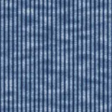](https://github.com/Artbyo3/DEVIL-PAINTER_Asset_Library/releases/tag/shelf-cloth-textures-vol1) `corduroy-10.png` [Shelf](https://github.com/Artbyo3/DEVIL-PAINTER_Asset_Library/releases/tag/shelf-cloth-textures-vol1) · [Public](https://github.com/Artbyo3/DEVIL-PAINTER_Asset_Library/releases/download/cloth-textures-vol1-v1.0.0/corduroy-10.png) |
| [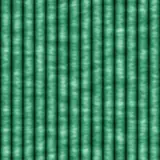](https://github.com/Artbyo3/DEVIL-PAINTER_Asset_Library/releases/tag/shelf-cloth-textures-vol1) `corduroy-11.png` [Shelf](https://github.com/Artbyo3/DEVIL-PAINTER_Asset_Library/releases/tag/shelf-cloth-textures-vol1) · [Public](https://github.com/Artbyo3/DEVIL-PAINTER_Asset_Library/releases/download/cloth-textures-vol1-v1.0.0/corduroy-11.png) | [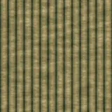](https://github.com/Artbyo3/DEVIL-PAINTER_Asset_Library/releases/tag/shelf-cloth-textures-vol1) `corduroy-12.png` [Shelf](https://github.com/Artbyo3/DEVIL-PAINTER_Asset_Library/releases/tag/shelf-cloth-textures-vol1) · [Public](https://github.com/Artbyo3/DEVIL-PAINTER_Asset_Library/releases/download/cloth-textures-vol1-v1.0.0/corduroy-12.png) |  `corduroy-13.png` [Shelf](https://github.com/Artbyo3/DEVIL-PAINTER_Asset_Library/releases/tag/shelf-cloth-textures-vol1) · [Public](https://github.com/Artbyo3/DEVIL-PAINTER_Asset_Library/releases/download/cloth-textures-vol1-v1.0.0/corduroy-13.png) |  `corduroy-14.png` [Shelf](https://github.com/Artbyo3/DEVIL-PAINTER_Asset_Library/releases/tag/shelf-cloth-textures-vol1) · [Public](https://github.com/Artbyo3/DEVIL-PAINTER_Asset_Library/releases/download/cloth-textures-vol1-v1.0.0/corduroy-14.png) |
| [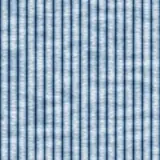](https://github.com/Artbyo3/DEVIL-PAINTER_Asset_Library/releases/tag/shelf-cloth-textures-vol1) `corduroy-15.png` [Shelf](https://github.com/Artbyo3/DEVIL-PAINTER_Asset_Library/releases/tag/shelf-cloth-textures-vol1) · [Public](https://github.com/Artbyo3/DEVIL-PAINTER_Asset_Library/releases/download/cloth-textures-vol1-v1.0.0/corduroy-15.png) |  `corduroy-16.png` [Shelf](https://github.com/Artbyo3/DEVIL-PAINTER_Asset_Library/releases/tag/shelf-cloth-textures-vol1) · [Public](https://github.com/Artbyo3/DEVIL-PAINTER_Asset_Library/releases/download/cloth-textures-vol1-v1.0.0/corduroy-16.png) | [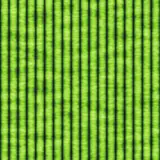](https://github.com/Artbyo3/DEVIL-PAINTER_Asset_Library/releases/tag/shelf-cloth-textures-vol1) `corduroy-17.png` [Shelf](https://github.com/Artbyo3/DEVIL-PAINTER_Asset_Library/releases/tag/shelf-cloth-textures-vol1) · [Public](https://github.com/Artbyo3/DEVIL-PAINTER_Asset_Library/releases/download/cloth-textures-vol1-v1.0.0/corduroy-17.png) |  `corduroy-18.png` [Shelf](https://github.com/Artbyo3/DEVIL-PAINTER_Asset_Library/releases/tag/shelf-cloth-textures-vol1) · [Public](https://github.com/Artbyo3/DEVIL-PAINTER_Asset_Library/releases/download/cloth-textures-vol1-v1.0.0/corduroy-18.png) |
| [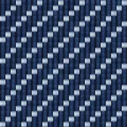](https://github.com/Artbyo3/DEVIL-PAINTER_Asset_Library/releases/tag/shelf-cloth-textures-vol1) `denim-twill-01.png` [Shelf](https://github.com/Artbyo3/DEVIL-PAINTER_Asset_Library/releases/tag/shelf-cloth-textures-vol1) · [Public](https://github.com/Artbyo3/DEVIL-PAINTER_Asset_Library/releases/download/cloth-textures-vol1-v1.0.0/denim-twill-01.png) | [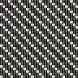](https://github.com/Artbyo3/DEVIL-PAINTER_Asset_Library/releases/tag/shelf-cloth-textures-vol1) `denim-twill-02.png` [Shelf](https://github.com/Artbyo3/DEVIL-PAINTER_Asset_Library/releases/tag/shelf-cloth-textures-vol1) · [Public](https://github.com/Artbyo3/DEVIL-PAINTER_Asset_Library/releases/download/cloth-textures-vol1-v1.0.0/denim-twill-02.png) | [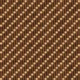](https://github.com/Artbyo3/DEVIL-PAINTER_Asset_Library/releases/tag/shelf-cloth-textures-vol1) `denim-twill-03.png` [Shelf](https://github.com/Artbyo3/DEVIL-PAINTER_Asset_Library/releases/tag/shelf-cloth-textures-vol1) · [Public](https://github.com/Artbyo3/DEVIL-PAINTER_Asset_Library/releases/download/cloth-textures-vol1-v1.0.0/denim-twill-03.png) |  `denim-twill-04.png` [Shelf](https://github.com/Artbyo3/DEVIL-PAINTER_Asset_Library/releases/tag/shelf-cloth-textures-vol1) · [Public](https://github.com/Artbyo3/DEVIL-PAINTER_Asset_Library/releases/download/cloth-textures-vol1-v1.0.0/denim-twill-04.png) |
| [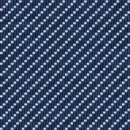](https://github.com/Artbyo3/DEVIL-PAINTER_Asset_Library/releases/tag/shelf-cloth-textures-vol1) `denim-twill-05.png` [Shelf](https://github.com/Artbyo3/DEVIL-PAINTER_Asset_Library/releases/tag/shelf-cloth-textures-vol1) · [Public](https://github.com/Artbyo3/DEVIL-PAINTER_Asset_Library/releases/download/cloth-textures-vol1-v1.0.0/denim-twill-05.png) | [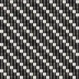](https://github.com/Artbyo3/DEVIL-PAINTER_Asset_Library/releases/tag/shelf-cloth-textures-vol1) `denim-twill-06.png` [Shelf](https://github.com/Artbyo3/DEVIL-PAINTER_Asset_Library/releases/tag/shelf-cloth-textures-vol1) · [Public](https://github.com/Artbyo3/DEVIL-PAINTER_Asset_Library/releases/download/cloth-textures-vol1-v1.0.0/denim-twill-06.png) |  `denim-twill-07.png` [Shelf](https://github.com/Artbyo3/DEVIL-PAINTER_Asset_Library/releases/tag/shelf-cloth-textures-vol1) · [Public](https://github.com/Artbyo3/DEVIL-PAINTER_Asset_Library/releases/download/cloth-textures-vol1-v1.0.0/denim-twill-07.png) |  `denim-twill-08.png` [Shelf](https://github.com/Artbyo3/DEVIL-PAINTER_Asset_Library/releases/tag/shelf-cloth-textures-vol1) · [Public](https://github.com/Artbyo3/DEVIL-PAINTER_Asset_Library/releases/download/cloth-textures-vol1-v1.0.0/denim-twill-08.png) |
|  `denim-twill-09.png` [Shelf](https://github.com/Artbyo3/DEVIL-PAINTER_Asset_Library/releases/tag/shelf-cloth-textures-vol1) · [Public](https://github.com/Artbyo3/DEVIL-PAINTER_Asset_Library/releases/download/cloth-textures-vol1-v1.0.0/denim-twill-09.png) | [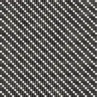](https://github.com/Artbyo3/DEVIL-PAINTER_Asset_Library/releases/tag/shelf-cloth-textures-vol1) `denim-twill-10.png` [Shelf](https://github.com/Artbyo3/DEVIL-PAINTER_Asset_Library/releases/tag/shelf-cloth-textures-vol1) · [Public](https://github.com/Artbyo3/DEVIL-PAINTER_Asset_Library/releases/download/cloth-textures-vol1-v1.0.0/denim-twill-10.png) |  `denim-twill-11.png` [Shelf](https://github.com/Artbyo3/DEVIL-PAINTER_Asset_Library/releases/tag/shelf-cloth-textures-vol1) · [Public](https://github.com/Artbyo3/DEVIL-PAINTER_Asset_Library/releases/download/cloth-textures-vol1-v1.0.0/denim-twill-11.png) | [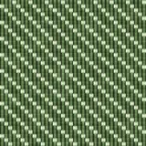](https://github.com/Artbyo3/DEVIL-PAINTER_Asset_Library/releases/tag/shelf-cloth-textures-vol1) `denim-twill-12.png` [Shelf](https://github.com/Artbyo3/DEVIL-PAINTER_Asset_Library/releases/tag/shelf-cloth-textures-vol1) · [Public](https://github.com/Artbyo3/DEVIL-PAINTER_Asset_Library/releases/download/cloth-textures-vol1-v1.0.0/denim-twill-12.png) |
|  `denim-twill-13.png` [Shelf](https://github.com/Artbyo3/DEVIL-PAINTER_Asset_Library/releases/tag/shelf-cloth-textures-vol1) · [Public](https://github.com/Artbyo3/DEVIL-PAINTER_Asset_Library/releases/download/cloth-textures-vol1-v1.0.0/denim-twill-13.png) |  `denim-twill-14.png` [Shelf](https://github.com/Artbyo3/DEVIL-PAINTER_Asset_Library/releases/tag/shelf-cloth-textures-vol1) · [Public](https://github.com/Artbyo3/DEVIL-PAINTER_Asset_Library/releases/download/cloth-textures-vol1-v1.0.0/denim-twill-14.png) |  `denim-twill-15.png` [Shelf](https://github.com/Artbyo3/DEVIL-PAINTER_Asset_Library/releases/tag/shelf-cloth-textures-vol1) · [Public](https://github.com/Artbyo3/DEVIL-PAINTER_Asset_Library/releases/download/cloth-textures-vol1-v1.0.0/denim-twill-15.png) |  `denim-twill-16.png` [Shelf](https://github.com/Artbyo3/DEVIL-PAINTER_Asset_Library/releases/tag/shelf-cloth-textures-vol1) · [Public](https://github.com/Artbyo3/DEVIL-PAINTER_Asset_Library/releases/download/cloth-textures-vol1-v1.0.0/denim-twill-16.png) |
|  `denim-twill-17.png` [Shelf](https://github.com/Artbyo3/DEVIL-PAINTER_Asset_Library/releases/tag/shelf-cloth-textures-vol1) · [Public](https://github.com/Artbyo3/DEVIL-PAINTER_Asset_Library/releases/download/cloth-textures-vol1-v1.0.0/denim-twill-17.png) |  `denim-twill-18.png` [Shelf](https://github.com/Artbyo3/DEVIL-PAINTER_Asset_Library/releases/tag/shelf-cloth-textures-vol1) · [Public](https://github.com/Artbyo3/DEVIL-PAINTER_Asset_Library/releases/download/cloth-textures-vol1-v1.0.0/denim-twill-18.png) |  `denim-twill-19.png` [Shelf](https://github.com/Artbyo3/DEVIL-PAINTER_Asset_Library/releases/tag/shelf-cloth-textures-vol1) · [Public](https://github.com/Artbyo3/DEVIL-PAINTER_Asset_Library/releases/download/cloth-textures-vol1-v1.0.0/denim-twill-19.png) |  `denim-twill-20.png` [Shelf](https://github.com/Artbyo3/DEVIL-PAINTER_Asset_Library/releases/tag/shelf-cloth-textures-vol1) · [Public](https://github.com/Artbyo3/DEVIL-PAINTER_Asset_Library/releases/download/cloth-textures-vol1-v1.0.0/denim-twill-20.png) |
|  `denim-twill-21.png` [Shelf](https://github.com/Artbyo3/DEVIL-PAINTER_Asset_Library/releases/tag/shelf-cloth-textures-vol1) · [Public](https://github.com/Artbyo3/DEVIL-PAINTER_Asset_Library/releases/download/cloth-textures-vol1-v1.0.0/denim-twill-21.png) |  `herringbone-weave-01.png` [Shelf](https://github.com/Artbyo3/DEVIL-PAINTER_Asset_Library/releases/tag/shelf-cloth-textures-vol1) · [Public](https://github.com/Artbyo3/DEVIL-PAINTER_Asset_Library/releases/download/cloth-textures-vol1-v1.0.0/herringbone-weave-01.png) |  `herringbone-weave-02.png` [Shelf](https://github.com/Artbyo3/DEVIL-PAINTER_Asset_Library/releases/tag/shelf-cloth-textures-vol1) · [Public](https://github.com/Artbyo3/DEVIL-PAINTER_Asset_Library/releases/download/cloth-textures-vol1-v1.0.0/herringbone-weave-02.png) |  `herringbone-weave-03.png` [Shelf](https://github.com/Artbyo3/DEVIL-PAINTER_Asset_Library/releases/tag/shelf-cloth-textures-vol1) · [Public](https://github.com/Artbyo3/DEVIL-PAINTER_Asset_Library/releases/download/cloth-textures-vol1-v1.0.0/herringbone-weave-03.png) |
|  `herringbone-weave-04.png` [Shelf](https://github.com/Artbyo3/DEVIL-PAINTER_Asset_Library/releases/tag/shelf-cloth-textures-vol1) · [Public](https://github.com/Artbyo3/DEVIL-PAINTER_Asset_Library/releases/download/cloth-textures-vol1-v1.0.0/herringbone-weave-04.png) |  `herringbone-weave-05.png` [Shelf](https://github.com/Artbyo3/DEVIL-PAINTER_Asset_Library/releases/tag/shelf-cloth-textures-vol1) · [Public](https://github.com/Artbyo3/DEVIL-PAINTER_Asset_Library/releases/download/cloth-textures-vol1-v1.0.0/herringbone-weave-05.png) |  `herringbone-weave-06.png` [Shelf](https://github.com/Artbyo3/DEVIL-PAINTER_Asset_Library/releases/tag/shelf-cloth-textures-vol1) · [Public](https://github.com/Artbyo3/DEVIL-PAINTER_Asset_Library/releases/download/cloth-textures-vol1-v1.0.0/herringbone-weave-06.png) |  `herringbone-weave-07.png` [Shelf](https://github.com/Artbyo3/DEVIL-PAINTER_Asset_Library/releases/tag/shelf-cloth-textures-vol1) · [Public](https://github.com/Artbyo3/DEVIL-PAINTER_Asset_Library/releases/download/cloth-textures-vol1-v1.0.0/herringbone-weave-07.png) |
|  `herringbone-weave-08.png` [Shelf](https://github.com/Artbyo3/DEVIL-PAINTER_Asset_Library/releases/tag/shelf-cloth-textures-vol1) · [Public](https://github.com/Artbyo3/DEVIL-PAINTER_Asset_Library/releases/download/cloth-textures-vol1-v1.0.0/herringbone-weave-08.png) |  `herringbone-weave-09.png` [Shelf](https://github.com/Artbyo3/DEVIL-PAINTER_Asset_Library/releases/tag/shelf-cloth-textures-vol1) · [Public](https://github.com/Artbyo3/DEVIL-PAINTER_Asset_Library/releases/download/cloth-textures-vol1-v1.0.0/herringbone-weave-09.png) |  `herringbone-weave-10.png` [Shelf](https://github.com/Artbyo3/DEVIL-PAINTER_Asset_Library/releases/tag/shelf-cloth-textures-vol1) · [Public](https://github.com/Artbyo3/DEVIL-PAINTER_Asset_Library/releases/download/cloth-textures-vol1-v1.0.0/herringbone-weave-10.png) |  `herringbone-weave-11.png` [Shelf](https://github.com/Artbyo3/DEVIL-PAINTER_Asset_Library/releases/tag/shelf-cloth-textures-vol1) · [Public](https://github.com/Artbyo3/DEVIL-PAINTER_Asset_Library/releases/download/cloth-textures-vol1-v1.0.0/herringbone-weave-11.png) |
|  `herringbone-weave-12.png` [Shelf](https://github.com/Artbyo3/DEVIL-PAINTER_Asset_Library/releases/tag/shelf-cloth-textures-vol1) · [Public](https://github.com/Artbyo3/DEVIL-PAINTER_Asset_Library/releases/download/cloth-textures-vol1-v1.0.0/herringbone-weave-12.png) |  `herringbone-weave-13.png` [Shelf](https://github.com/Artbyo3/DEVIL-PAINTER_Asset_Library/releases/tag/shelf-cloth-textures-vol1) · [Public](https://github.com/Artbyo3/DEVIL-PAINTER_Asset_Library/releases/download/cloth-textures-vol1-v1.0.0/herringbone-weave-13.png) |  `herringbone-weave-14.png` [Shelf](https://github.com/Artbyo3/DEVIL-PAINTER_Asset_Library/releases/tag/shelf-cloth-textures-vol1) · [Public](https://github.com/Artbyo3/DEVIL-PAINTER_Asset_Library/releases/download/cloth-textures-vol1-v1.0.0/herringbone-weave-14.png) |  `herringbone-weave-15.png` [Shelf](https://github.com/Artbyo3/DEVIL-PAINTER_Asset_Library/releases/tag/shelf-cloth-textures-vol1) · [Public](https://github.com/Artbyo3/DEVIL-PAINTER_Asset_Library/releases/download/cloth-textures-vol1-v1.0.0/herringbone-weave-15.png) |
|  `herringbone-weave-16.png` [Shelf](https://github.com/Artbyo3/DEVIL-PAINTER_Asset_Library/releases/tag/shelf-cloth-textures-vol1) · [Public](https://github.com/Artbyo3/DEVIL-PAINTER_Asset_Library/releases/download/cloth-textures-vol1-v1.0.0/herringbone-weave-16.png) |  `herringbone-weave-17.png` [Shelf](https://github.com/Artbyo3/DEVIL-PAINTER_Asset_Library/releases/tag/shelf-cloth-textures-vol1) · [Public](https://github.com/Artbyo3/DEVIL-PAINTER_Asset_Library/releases/download/cloth-textures-vol1-v1.0.0/herringbone-weave-17.png) |  `herringbone-weave-18.png` [Shelf](https://github.com/Artbyo3/DEVIL-PAINTER_Asset_Library/releases/tag/shelf-cloth-textures-vol1) · [Public](https://github.com/Artbyo3/DEVIL-PAINTER_Asset_Library/releases/download/cloth-textures-vol1-v1.0.0/herringbone-weave-18.png) |  `herringbone-weave-19.png` [Shelf](https://github.com/Artbyo3/DEVIL-PAINTER_Asset_Library/releases/tag/shelf-cloth-textures-vol1) · [Public](https://github.com/Artbyo3/DEVIL-PAINTER_Asset_Library/releases/download/cloth-textures-vol1-v1.0.0/herringbone-weave-19.png) |
|  `herringbone-weave-20.png` [Shelf](https://github.com/Artbyo3/DEVIL-PAINTER_Asset_Library/releases/tag/shelf-cloth-textures-vol1) · [Public](https://github.com/Artbyo3/DEVIL-PAINTER_Asset_Library/releases/download/cloth-textures-vol1-v1.0.0/herringbone-weave-20.png) |  `herringbone-weave-21.png` [Shelf](https://github.com/Artbyo3/DEVIL-PAINTER_Asset_Library/releases/tag/shelf-cloth-textures-vol1) · [Public](https://github.com/Artbyo3/DEVIL-PAINTER_Asset_Library/releases/download/cloth-textures-vol1-v1.0.0/herringbone-weave-21.png) |  `herringbone-weave-22.png` [Shelf](https://github.com/Artbyo3/DEVIL-PAINTER_Asset_Library/releases/tag/shelf-cloth-textures-vol1) · [Public](https://github.com/Artbyo3/DEVIL-PAINTER_Asset_Library/releases/download/cloth-textures-vol1-v1.0.0/herringbone-weave-22.png) |  `herringbone-weave-23.png` [Shelf](https://github.com/Artbyo3/DEVIL-PAINTER_Asset_Library/releases/tag/shelf-cloth-textures-vol1) · [Public](https://github.com/Artbyo3/DEVIL-PAINTER_Asset_Library/releases/download/cloth-textures-vol1-v1.0.0/herringbone-weave-23.png) |
|  `herringbone-weave-24.png` [Shelf](https://github.com/Artbyo3/DEVIL-PAINTER_Asset_Library/releases/tag/shelf-cloth-textures-vol1) · [Public](https://github.com/Artbyo3/DEVIL-PAINTER_Asset_Library/releases/download/cloth-textures-vol1-v1.0.0/herringbone-weave-24.png) |  `herringbone-weave-25.png` [Shelf](https://github.com/Artbyo3/DEVIL-PAINTER_Asset_Library/releases/tag/shelf-cloth-textures-vol1) · [Public](https://github.com/Artbyo3/DEVIL-PAINTER_Asset_Library/releases/download/cloth-textures-vol1-v1.0.0/herringbone-weave-25.png) |  `herringbone-weave-26.png` [Shelf](https://github.com/Artbyo3/DEVIL-PAINTER_Asset_Library/releases/tag/shelf-cloth-textures-vol1) · [Public](https://github.com/Artbyo3/DEVIL-PAINTER_Asset_Library/releases/download/cloth-textures-vol1-v1.0.0/herringbone-weave-26.png) |  `herringbone-weave-27.png` [Shelf](https://github.com/Artbyo3/DEVIL-PAINTER_Asset_Library/releases/tag/shelf-cloth-textures-vol1) · [Public](https://github.com/Artbyo3/DEVIL-PAINTER_Asset_Library/releases/download/cloth-textures-vol1-v1.0.0/herringbone-weave-27.png) |
|  `houndstooth-wool-01.png` [Shelf](https://github.com/Artbyo3/DEVIL-PAINTER_Asset_Library/releases/tag/shelf-cloth-textures-vol1) · [Public](https://github.com/Artbyo3/DEVIL-PAINTER_Asset_Library/releases/download/cloth-textures-vol1-v1.0.0/houndstooth-wool-01.png) |  `houndstooth-wool-02.png` [Shelf](https://github.com/Artbyo3/DEVIL-PAINTER_Asset_Library/releases/tag/shelf-cloth-textures-vol1) · [Public](https://github.com/Artbyo3/DEVIL-PAINTER_Asset_Library/releases/download/cloth-textures-vol1-v1.0.0/houndstooth-wool-02.png) |  `houndstooth-wool-03.png` [Shelf](https://github.com/Artbyo3/DEVIL-PAINTER_Asset_Library/releases/tag/shelf-cloth-textures-vol1) · [Public](https://github.com/Artbyo3/DEVIL-PAINTER_Asset_Library/releases/download/cloth-textures-vol1-v1.0.0/houndstooth-wool-03.png) |  `houndstooth-wool-04.png` [Shelf](https://github.com/Artbyo3/DEVIL-PAINTER_Asset_Library/releases/tag/shelf-cloth-textures-vol1) · [Public](https://github.com/Artbyo3/DEVIL-PAINTER_Asset_Library/releases/download/cloth-textures-vol1-v1.0.0/houndstooth-wool-04.png) |
|  `houndstooth-wool-05.png` [Shelf](https://github.com/Artbyo3/DEVIL-PAINTER_Asset_Library/releases/tag/shelf-cloth-textures-vol1) · [Public](https://github.com/Artbyo3/DEVIL-PAINTER_Asset_Library/releases/download/cloth-textures-vol1-v1.0.0/houndstooth-wool-05.png) |  `houndstooth-wool-06.png` [Shelf](https://github.com/Artbyo3/DEVIL-PAINTER_Asset_Library/releases/tag/shelf-cloth-textures-vol1) · [Public](https://github.com/Artbyo3/DEVIL-PAINTER_Asset_Library/releases/download/cloth-textures-vol1-v1.0.0/houndstooth-wool-06.png) |  `houndstooth-wool-07.png` [Shelf](https://github.com/Artbyo3/DEVIL-PAINTER_Asset_Library/releases/tag/shelf-cloth-textures-vol1) · [Public](https://github.com/Artbyo3/DEVIL-PAINTER_Asset_Library/releases/download/cloth-textures-vol1-v1.0.0/houndstooth-wool-07.png) |  `houndstooth-wool-08.png` [Shelf](https://github.com/Artbyo3/DEVIL-PAINTER_Asset_Library/releases/tag/shelf-cloth-textures-vol1) · [Public](https://github.com/Artbyo3/DEVIL-PAINTER_Asset_Library/releases/download/cloth-textures-vol1-v1.0.0/houndstooth-wool-08.png) |
|  `houndstooth-wool-09.png` [Shelf](https://github.com/Artbyo3/DEVIL-PAINTER_Asset_Library/releases/tag/shelf-cloth-textures-vol1) · [Public](https://github.com/Artbyo3/DEVIL-PAINTER_Asset_Library/releases/download/cloth-textures-vol1-v1.0.0/houndstooth-wool-09.png) |  `houndstooth-wool-10.png` [Shelf](https://github.com/Artbyo3/DEVIL-PAINTER_Asset_Library/releases/tag/shelf-cloth-textures-vol1) · [Public](https://github.com/Artbyo3/DEVIL-PAINTER_Asset_Library/releases/download/cloth-textures-vol1-v1.0.0/houndstooth-wool-10.png) |  `houndstooth-wool-11.png` [Shelf](https://github.com/Artbyo3/DEVIL-PAINTER_Asset_Library/releases/tag/shelf-cloth-textures-vol1) · [Public](https://github.com/Artbyo3/DEVIL-PAINTER_Asset_Library/releases/download/cloth-textures-vol1-v1.0.0/houndstooth-wool-11.png) |  `houndstooth-wool-12.png` [Shelf](https://github.com/Artbyo3/DEVIL-PAINTER_Asset_Library/releases/tag/shelf-cloth-textures-vol1) · [Public](https://github.com/Artbyo3/DEVIL-PAINTER_Asset_Library/releases/download/cloth-textures-vol1-v1.0.0/houndstooth-wool-12.png) |
|  `jacquard-diamond-01.png` [Shelf](https://github.com/Artbyo3/DEVIL-PAINTER_Asset_Library/releases/tag/shelf-cloth-textures-vol1) · [Public](https://github.com/Artbyo3/DEVIL-PAINTER_Asset_Library/releases/download/cloth-textures-vol1-v1.0.0/jacquard-diamond-01.png) |  `jacquard-diamond-02.png` [Shelf](https://github.com/Artbyo3/DEVIL-PAINTER_Asset_Library/releases/tag/shelf-cloth-textures-vol1) · [Public](https://github.com/Artbyo3/DEVIL-PAINTER_Asset_Library/releases/download/cloth-textures-vol1-v1.0.0/jacquard-diamond-02.png) |  `jacquard-diamond-03.png` [Shelf](https://github.com/Artbyo3/DEVIL-PAINTER_Asset_Library/releases/tag/shelf-cloth-textures-vol1) · [Public](https://github.com/Artbyo3/DEVIL-PAINTER_Asset_Library/releases/download/cloth-textures-vol1-v1.0.0/jacquard-diamond-03.png) |  `jacquard-diamond-04.png` [Shelf](https://github.com/Artbyo3/DEVIL-PAINTER_Asset_Library/releases/tag/shelf-cloth-textures-vol1) · [Public](https://github.com/Artbyo3/DEVIL-PAINTER_Asset_Library/releases/download/cloth-textures-vol1-v1.0.0/jacquard-diamond-04.png) |
|  `jacquard-diamond-05.png` [Shelf](https://github.com/Artbyo3/DEVIL-PAINTER_Asset_Library/releases/tag/shelf-cloth-textures-vol1) · [Public](https://github.com/Artbyo3/DEVIL-PAINTER_Asset_Library/releases/download/cloth-textures-vol1-v1.0.0/jacquard-diamond-05.png) |  `jacquard-diamond-06.png` [Shelf](https://github.com/Artbyo3/DEVIL-PAINTER_Asset_Library/releases/tag/shelf-cloth-textures-vol1) · [Public](https://github.com/Artbyo3/DEVIL-PAINTER_Asset_Library/releases/download/cloth-textures-vol1-v1.0.0/jacquard-diamond-06.png) |  `jacquard-medallion-01.png` [Shelf](https://github.com/Artbyo3/DEVIL-PAINTER_Asset_Library/releases/tag/shelf-cloth-textures-vol1) · [Public](https://github.com/Artbyo3/DEVIL-PAINTER_Asset_Library/releases/download/cloth-textures-vol1-v1.0.0/jacquard-medallion-01.png) |  `jacquard-medallion-02.png` [Shelf](https://github.com/Artbyo3/DEVIL-PAINTER_Asset_Library/releases/tag/shelf-cloth-textures-vol1) · [Public](https://github.com/Artbyo3/DEVIL-PAINTER_Asset_Library/releases/download/cloth-textures-vol1-v1.0.0/jacquard-medallion-02.png) |
|  `jacquard-medallion-03.png` [Shelf](https://github.com/Artbyo3/DEVIL-PAINTER_Asset_Library/releases/tag/shelf-cloth-textures-vol1) · [Public](https://github.com/Artbyo3/DEVIL-PAINTER_Asset_Library/releases/download/cloth-textures-vol1-v1.0.0/jacquard-medallion-03.png) |  `jacquard-medallion-04.png` [Shelf](https://github.com/Artbyo3/DEVIL-PAINTER_Asset_Library/releases/tag/shelf-cloth-textures-vol1) · [Public](https://github.com/Artbyo3/DEVIL-PAINTER_Asset_Library/releases/download/cloth-textures-vol1-v1.0.0/jacquard-medallion-04.png) |  `jacquard-medallion-05.png` [Shelf](https://github.com/Artbyo3/DEVIL-PAINTER_Asset_Library/releases/tag/shelf-cloth-textures-vol1) · [Public](https://github.com/Artbyo3/DEVIL-PAINTER_Asset_Library/releases/download/cloth-textures-vol1-v1.0.0/jacquard-medallion-05.png) |  `jacquard-medallion-06.png` [Shelf](https://github.com/Artbyo3/DEVIL-PAINTER_Asset_Library/releases/tag/shelf-cloth-textures-vol1) · [Public](https://github.com/Artbyo3/DEVIL-PAINTER_Asset_Library/releases/download/cloth-textures-vol1-v1.0.0/jacquard-medallion-06.png) |
|  `jacquard-medallion-07.png` [Shelf](https://github.com/Artbyo3/DEVIL-PAINTER_Asset_Library/releases/tag/shelf-cloth-textures-vol1) · [Public](https://github.com/Artbyo3/DEVIL-PAINTER_Asset_Library/releases/download/cloth-textures-vol1-v1.0.0/jacquard-medallion-07.png) |  `jacquard-zigzag-01.png` [Shelf](https://github.com/Artbyo3/DEVIL-PAINTER_Asset_Library/releases/tag/shelf-cloth-textures-vol1) · [Public](https://github.com/Artbyo3/DEVIL-PAINTER_Asset_Library/releases/download/cloth-textures-vol1-v1.0.0/jacquard-zigzag-01.png) |  `jacquard-zigzag-02.png` [Shelf](https://github.com/Artbyo3/DEVIL-PAINTER_Asset_Library/releases/tag/shelf-cloth-textures-vol1) · [Public](https://github.com/Artbyo3/DEVIL-PAINTER_Asset_Library/releases/download/cloth-textures-vol1-v1.0.0/jacquard-zigzag-02.png) |  `jacquard-zigzag-03.png` [Shelf](https://github.com/Artbyo3/DEVIL-PAINTER_Asset_Library/releases/tag/shelf-cloth-textures-vol1) · [Public](https://github.com/Artbyo3/DEVIL-PAINTER_Asset_Library/releases/download/cloth-textures-vol1-v1.0.0/jacquard-zigzag-03.png) |
|  `jacquard-zigzag-04.png` [Shelf](https://github.com/Artbyo3/DEVIL-PAINTER_Asset_Library/releases/tag/shelf-cloth-textures-vol1) · [Public](https://github.com/Artbyo3/DEVIL-PAINTER_Asset_Library/releases/download/cloth-textures-vol1-v1.0.0/jacquard-zigzag-04.png) |  `jacquard-zigzag-05.png` [Shelf](https://github.com/Artbyo3/DEVIL-PAINTER_Asset_Library/releases/tag/shelf-cloth-textures-vol1) · [Public](https://github.com/Artbyo3/DEVIL-PAINTER_Asset_Library/releases/download/cloth-textures-vol1-v1.0.0/jacquard-zigzag-05.png) |  `jacquard-zigzag-06.png` [Shelf](https://github.com/Artbyo3/DEVIL-PAINTER_Asset_Library/releases/tag/shelf-cloth-textures-vol1) · [Public](https://github.com/Artbyo3/DEVIL-PAINTER_Asset_Library/releases/download/cloth-textures-vol1-v1.0.0/jacquard-zigzag-06.png) |  `jacquard-zigzag-07.png` [Shelf](https://github.com/Artbyo3/DEVIL-PAINTER_Asset_Library/releases/tag/shelf-cloth-textures-vol1) · [Public](https://github.com/Artbyo3/DEVIL-PAINTER_Asset_Library/releases/download/cloth-textures-vol1-v1.0.0/jacquard-zigzag-07.png) |
|  `jacquard-zigzag-08.png` [Shelf](https://github.com/Artbyo3/DEVIL-PAINTER_Asset_Library/releases/tag/shelf-cloth-textures-vol1) · [Public](https://github.com/Artbyo3/DEVIL-PAINTER_Asset_Library/releases/download/cloth-textures-vol1-v1.0.0/jacquard-zigzag-08.png) |  `jacquard-zigzag-09.png` [Shelf](https://github.com/Artbyo3/DEVIL-PAINTER_Asset_Library/releases/tag/shelf-cloth-textures-vol1) · [Public](https://github.com/Artbyo3/DEVIL-PAINTER_Asset_Library/releases/download/cloth-textures-vol1-v1.0.0/jacquard-zigzag-09.png) |  `silk-brocade-01.png` [Shelf](https://github.com/Artbyo3/DEVIL-PAINTER_Asset_Library/releases/tag/shelf-cloth-textures-vol1) · [Public](https://github.com/Artbyo3/DEVIL-PAINTER_Asset_Library/releases/download/cloth-textures-vol1-v1.0.0/silk-brocade-01.png) |  `silk-brocade-02.png` [Shelf](https://github.com/Artbyo3/DEVIL-PAINTER_Asset_Library/releases/tag/shelf-cloth-textures-vol1) · [Public](https://github.com/Artbyo3/DEVIL-PAINTER_Asset_Library/releases/download/cloth-textures-vol1-v1.0.0/silk-brocade-02.png) |
|  `silk-brocade-03.png` [Shelf](https://github.com/Artbyo3/DEVIL-PAINTER_Asset_Library/releases/tag/shelf-cloth-textures-vol1) · [Public](https://github.com/Artbyo3/DEVIL-PAINTER_Asset_Library/releases/download/cloth-textures-vol1-v1.0.0/silk-brocade-03.png) |  `silk-brocade-04.png` [Shelf](https://github.com/Artbyo3/DEVIL-PAINTER_Asset_Library/releases/tag/shelf-cloth-textures-vol1) · [Public](https://github.com/Artbyo3/DEVIL-PAINTER_Asset_Library/releases/download/cloth-textures-vol1-v1.0.0/silk-brocade-04.png) |  `silk-brocade-05.png` [Shelf](https://github.com/Artbyo3/DEVIL-PAINTER_Asset_Library/releases/tag/shelf-cloth-textures-vol1) · [Public](https://github.com/Artbyo3/DEVIL-PAINTER_Asset_Library/releases/download/cloth-textures-vol1-v1.0.0/silk-brocade-05.png) |  `silk-brocade-06.png` [Shelf](https://github.com/Artbyo3/DEVIL-PAINTER_Asset_Library/releases/tag/shelf-cloth-textures-vol1) · [Public](https://github.com/Artbyo3/DEVIL-PAINTER_Asset_Library/releases/download/cloth-textures-vol1-v1.0.0/silk-brocade-06.png) |
|  `silk-brocade-07.png` [Shelf](https://github.com/Artbyo3/DEVIL-PAINTER_Asset_Library/releases/tag/shelf-cloth-textures-vol1) · [Public](https://github.com/Artbyo3/DEVIL-PAINTER_Asset_Library/releases/download/cloth-textures-vol1-v1.0.0/silk-brocade-07.png) |  `silk-brocade-08.png` [Shelf](https://github.com/Artbyo3/DEVIL-PAINTER_Asset_Library/releases/tag/shelf-cloth-textures-vol1) · [Public](https://github.com/Artbyo3/DEVIL-PAINTER_Asset_Library/releases/download/cloth-textures-vol1-v1.0.0/silk-brocade-08.png) |  `silk-brocade-09.png` [Shelf](https://github.com/Artbyo3/DEVIL-PAINTER_Asset_Library/releases/tag/shelf-cloth-textures-vol1) · [Public](https://github.com/Artbyo3/DEVIL-PAINTER_Asset_Library/releases/download/cloth-textures-vol1-v1.0.0/silk-brocade-09.png) |  `silk-brocade-10.png` [Shelf](https://github.com/Artbyo3/DEVIL-PAINTER_Asset_Library/releases/tag/shelf-cloth-textures-vol1) · [Public](https://github.com/Artbyo3/DEVIL-PAINTER_Asset_Library/releases/download/cloth-textures-vol1-v1.0.0/silk-brocade-10.png) |
|  `silk-brocade-11.png` [Shelf](https://github.com/Artbyo3/DEVIL-PAINTER_Asset_Library/releases/tag/shelf-cloth-textures-vol1) · [Public](https://github.com/Artbyo3/DEVIL-PAINTER_Asset_Library/releases/download/cloth-textures-vol1-v1.0.0/silk-brocade-11.png) |  `silk-brocade-12.png` [Shelf](https://github.com/Artbyo3/DEVIL-PAINTER_Asset_Library/releases/tag/shelf-cloth-textures-vol1) · [Public](https://github.com/Artbyo3/DEVIL-PAINTER_Asset_Library/releases/download/cloth-textures-vol1-v1.0.0/silk-brocade-12.png) |  `silk-brocade-13.png` [Shelf](https://github.com/Artbyo3/DEVIL-PAINTER_Asset_Library/releases/tag/shelf-cloth-textures-vol1) · [Public](https://github.com/Artbyo3/DEVIL-PAINTER_Asset_Library/releases/download/cloth-textures-vol1-v1.0.0/silk-brocade-13.png) |  `silk-brocade-14.png` [Shelf](https://github.com/Artbyo3/DEVIL-PAINTER_Asset_Library/releases/tag/shelf-cloth-textures-vol1) · [Public](https://github.com/Artbyo3/DEVIL-PAINTER_Asset_Library/releases/download/cloth-textures-vol1-v1.0.0/silk-brocade-14.png) |
|  `silk-brocade-15.png` [Shelf](https://github.com/Artbyo3/DEVIL-PAINTER_Asset_Library/releases/tag/shelf-cloth-textures-vol1) · [Public](https://github.com/Artbyo3/DEVIL-PAINTER_Asset_Library/releases/download/cloth-textures-vol1-v1.0.0/silk-brocade-15.png) |  `silk-brocade-16.png` [Shelf](https://github.com/Artbyo3/DEVIL-PAINTER_Asset_Library/releases/tag/shelf-cloth-textures-vol1) · [Public](https://github.com/Artbyo3/DEVIL-PAINTER_Asset_Library/releases/download/cloth-textures-vol1-v1.0.0/silk-brocade-16.png) |  `silk-brocade-17.png` [Shelf](https://github.com/Artbyo3/DEVIL-PAINTER_Asset_Library/releases/tag/shelf-cloth-textures-vol1) · [Public](https://github.com/Artbyo3/DEVIL-PAINTER_Asset_Library/releases/download/cloth-textures-vol1-v1.0.0/silk-brocade-17.png) |  `tartan-plaid-01.png` [Shelf](https://github.com/Artbyo3/DEVIL-PAINTER_Asset_Library/releases/tag/shelf-cloth-textures-vol1) · [Public](https://github.com/Artbyo3/DEVIL-PAINTER_Asset_Library/releases/download/cloth-textures-vol1-v1.0.0/tartan-plaid-01.png) |
|  `tartan-plaid-02.png` [Shelf](https://github.com/Artbyo3/DEVIL-PAINTER_Asset_Library/releases/tag/shelf-cloth-textures-vol1) · [Public](https://github.com/Artbyo3/DEVIL-PAINTER_Asset_Library/releases/download/cloth-textures-vol1-v1.0.0/tartan-plaid-02.png) |  `tartan-plaid-03.png` [Shelf](https://github.com/Artbyo3/DEVIL-PAINTER_Asset_Library/releases/tag/shelf-cloth-textures-vol1) · [Public](https://github.com/Artbyo3/DEVIL-PAINTER_Asset_Library/releases/download/cloth-textures-vol1-v1.0.0/tartan-plaid-03.png) |  `tartan-plaid-04.png` [Shelf](https://github.com/Artbyo3/DEVIL-PAINTER_Asset_Library/releases/tag/shelf-cloth-textures-vol1) · [Public](https://github.com/Artbyo3/DEVIL-PAINTER_Asset_Library/releases/download/cloth-textures-vol1-v1.0.0/tartan-plaid-04.png) |  `tartan-plaid-05.png` [Shelf](https://github.com/Artbyo3/DEVIL-PAINTER_Asset_Library/releases/tag/shelf-cloth-textures-vol1) · [Public](https://github.com/Artbyo3/DEVIL-PAINTER_Asset_Library/releases/download/cloth-textures-vol1-v1.0.0/tartan-plaid-05.png) |
|  `tartan-plaid-06.png` [Shelf](https://github.com/Artbyo3/DEVIL-PAINTER_Asset_Library/releases/tag/shelf-cloth-textures-vol1) · [Public](https://github.com/Artbyo3/DEVIL-PAINTER_Asset_Library/releases/download/cloth-textures-vol1-v1.0.0/tartan-plaid-06.png) |  `tartan-plaid-07.png` [Shelf](https://github.com/Artbyo3/DEVIL-PAINTER_Asset_Library/releases/tag/shelf-cloth-textures-vol1) · [Public](https://github.com/Artbyo3/DEVIL-PAINTER_Asset_Library/releases/download/cloth-textures-vol1-v1.0.0/tartan-plaid-07.png) |  `tartan-plaid-08.png` [Shelf](https://github.com/Artbyo3/DEVIL-PAINTER_Asset_Library/releases/tag/shelf-cloth-textures-vol1) · [Public](https://github.com/Artbyo3/DEVIL-PAINTER_Asset_Library/releases/download/cloth-textures-vol1-v1.0.0/tartan-plaid-08.png) |  `tartan-plaid-09.png` [Shelf](https://github.com/Artbyo3/DEVIL-PAINTER_Asset_Library/releases/tag/shelf-cloth-textures-vol1) · [Public](https://github.com/Artbyo3/DEVIL-PAINTER_Asset_Library/releases/download/cloth-textures-vol1-v1.0.0/tartan-plaid-09.png) |
|  `tartan-plaid-10.png` [Shelf](https://github.com/Artbyo3/DEVIL-PAINTER_Asset_Library/releases/tag/shelf-cloth-textures-vol1) · [Public](https://github.com/Artbyo3/DEVIL-PAINTER_Asset_Library/releases/download/cloth-textures-vol1-v1.0.0/tartan-plaid-10.png) |  `tartan-plaid-11.png` [Shelf](https://github.com/Artbyo3/DEVIL-PAINTER_Asset_Library/releases/tag/shelf-cloth-textures-vol1) · [Public](https://github.com/Artbyo3/DEVIL-PAINTER_Asset_Library/releases/download/cloth-textures-vol1-v1.0.0/tartan-plaid-11.png) |  `tartan-plaid-12.png` [Shelf](https://github.com/Artbyo3/DEVIL-PAINTER_Asset_Library/releases/tag/shelf-cloth-textures-vol1) · [Public](https://github.com/Artbyo3/DEVIL-PAINTER_Asset_Library/releases/download/cloth-textures-vol1-v1.0.0/tartan-plaid-12.png) |  `tartan-plaid-13.png` [Shelf](https://github.com/Artbyo3/DEVIL-PAINTER_Asset_Library/releases/tag/shelf-cloth-textures-vol1) · [Public](https://github.com/Artbyo3/DEVIL-PAINTER_Asset_Library/releases/download/cloth-textures-vol1-v1.0.0/tartan-plaid-13.png) |
|  `tartan-plaid-14.png` [Shelf](https://github.com/Artbyo3/DEVIL-PAINTER_Asset_Library/releases/tag/shelf-cloth-textures-vol1) · [Public](https://github.com/Artbyo3/DEVIL-PAINTER_Asset_Library/releases/download/cloth-textures-vol1-v1.0.0/tartan-plaid-14.png) |  `tartan-plaid-15.png` [Shelf](https://github.com/Artbyo3/DEVIL-PAINTER_Asset_Library/releases/tag/shelf-cloth-textures-vol1) · [Public](https://github.com/Artbyo3/DEVIL-PAINTER_Asset_Library/releases/download/cloth-textures-vol1-v1.0.0/tartan-plaid-15.png) |  `tartan-plaid-16.png` [Shelf](https://github.com/Artbyo3/DEVIL-PAINTER_Asset_Library/releases/tag/shelf-cloth-textures-vol1) · [Public](https://github.com/Artbyo3/DEVIL-PAINTER_Asset_Library/releases/download/cloth-textures-vol1-v1.0.0/tartan-plaid-16.png) |  `tartan-plaid-17.png` [Shelf](https://github.com/Artbyo3/DEVIL-PAINTER_Asset_Library/releases/tag/shelf-cloth-textures-vol1) · [Public](https://github.com/Artbyo3/DEVIL-PAINTER_Asset_Library/releases/download/cloth-textures-vol1-v1.0.0/tartan-plaid-17.png) |
