<!-- AUTO-GENERATED by tools/build_board.py — DO NOT HAND-EDIT -->

# Cloth Textures Vol. 2

[All Packs](README.md) · [Shelf Draft (`shelf-cloth-textures-vol2`)](https://github.com/Artbyo3/DEVIL-PAINTER_Asset_Library/releases/tag/untagged-d4cbd3b167b5845abf0d) · [Public Release (`cloth-textures-vol2-v1.0.0`)](https://github.com/Artbyo3/DEVIL-PAINTER_Asset_Library/releases/tag/cloth-textures-vol2-v1.0.0) · [Download Zip](https://github.com/Artbyo3/DEVIL-PAINTER_Asset_Library/releases/download/cloth-textures-vol2-v1.0.0/Cloth_Textures_Vol2.zip)

160 seamless 512x512 knit, quilted, and patterned fabric textures.

**Files:** 160 · **Zip Size:** 70.4 MB · **Tags:** `cloth`, `fabric`, `textile`, `apparel`, `knit`, `quilted`, `ripstop`, `seersucker`, `shibori`

| Asset 1 | Asset 2 | Asset 3 | Asset 4 |
| :---: | :---: | :---: | :---: |
|  `cable-knit-01.png` [Shelf](https://github.com/Artbyo3/DEVIL-PAINTER_Asset_Library/releases/tag/untagged-d4cbd3b167b5845abf0d) · [Public](https://github.com/Artbyo3/DEVIL-PAINTER_Asset_Library/releases/download/cloth-textures-vol2-v1.0.0/cable-knit-01.png) | [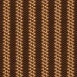](https://github.com/Artbyo3/DEVIL-PAINTER_Asset_Library/releases/tag/untagged-d4cbd3b167b5845abf0d) `cable-knit-02.png` [Shelf](https://github.com/Artbyo3/DEVIL-PAINTER_Asset_Library/releases/tag/untagged-d4cbd3b167b5845abf0d) · [Public](https://github.com/Artbyo3/DEVIL-PAINTER_Asset_Library/releases/download/cloth-textures-vol2-v1.0.0/cable-knit-02.png) |  `cable-knit-03.png` [Shelf](https://github.com/Artbyo3/DEVIL-PAINTER_Asset_Library/releases/tag/untagged-d4cbd3b167b5845abf0d) · [Public](https://github.com/Artbyo3/DEVIL-PAINTER_Asset_Library/releases/download/cloth-textures-vol2-v1.0.0/cable-knit-03.png) |  `cable-knit-04.png` [Shelf](https://github.com/Artbyo3/DEVIL-PAINTER_Asset_Library/releases/tag/untagged-d4cbd3b167b5845abf0d) · [Public](https://github.com/Artbyo3/DEVIL-PAINTER_Asset_Library/releases/download/cloth-textures-vol2-v1.0.0/cable-knit-04.png) |
|  `cable-knit-05.png` [Shelf](https://github.com/Artbyo3/DEVIL-PAINTER_Asset_Library/releases/tag/untagged-d4cbd3b167b5845abf0d) · [Public](https://github.com/Artbyo3/DEVIL-PAINTER_Asset_Library/releases/download/cloth-textures-vol2-v1.0.0/cable-knit-05.png) |  `cable-knit-06.png` [Shelf](https://github.com/Artbyo3/DEVIL-PAINTER_Asset_Library/releases/tag/untagged-d4cbd3b167b5845abf0d) · [Public](https://github.com/Artbyo3/DEVIL-PAINTER_Asset_Library/releases/download/cloth-textures-vol2-v1.0.0/cable-knit-06.png) |  `cable-knit-07.png` [Shelf](https://github.com/Artbyo3/DEVIL-PAINTER_Asset_Library/releases/tag/untagged-d4cbd3b167b5845abf0d) · [Public](https://github.com/Artbyo3/DEVIL-PAINTER_Asset_Library/releases/download/cloth-textures-vol2-v1.0.0/cable-knit-07.png) |  `cable-knit-08.png` [Shelf](https://github.com/Artbyo3/DEVIL-PAINTER_Asset_Library/releases/tag/untagged-d4cbd3b167b5845abf0d) · [Public](https://github.com/Artbyo3/DEVIL-PAINTER_Asset_Library/releases/download/cloth-textures-vol2-v1.0.0/cable-knit-08.png) |
|  `cable-knit-09.png` [Shelf](https://github.com/Artbyo3/DEVIL-PAINTER_Asset_Library/releases/tag/untagged-d4cbd3b167b5845abf0d) · [Public](https://github.com/Artbyo3/DEVIL-PAINTER_Asset_Library/releases/download/cloth-textures-vol2-v1.0.0/cable-knit-09.png) |  `cable-knit-10.png` [Shelf](https://github.com/Artbyo3/DEVIL-PAINTER_Asset_Library/releases/tag/untagged-d4cbd3b167b5845abf0d) · [Public](https://github.com/Artbyo3/DEVIL-PAINTER_Asset_Library/releases/download/cloth-textures-vol2-v1.0.0/cable-knit-10.png) |  `cable-knit-11.png` [Shelf](https://github.com/Artbyo3/DEVIL-PAINTER_Asset_Library/releases/tag/untagged-d4cbd3b167b5845abf0d) · [Public](https://github.com/Artbyo3/DEVIL-PAINTER_Asset_Library/releases/download/cloth-textures-vol2-v1.0.0/cable-knit-11.png) |  `cable-knit-12.png` [Shelf](https://github.com/Artbyo3/DEVIL-PAINTER_Asset_Library/releases/tag/untagged-d4cbd3b167b5845abf0d) · [Public](https://github.com/Artbyo3/DEVIL-PAINTER_Asset_Library/releases/download/cloth-textures-vol2-v1.0.0/cable-knit-12.png) |
|  `cable-knit-13.png` [Shelf](https://github.com/Artbyo3/DEVIL-PAINTER_Asset_Library/releases/tag/untagged-d4cbd3b167b5845abf0d) · [Public](https://github.com/Artbyo3/DEVIL-PAINTER_Asset_Library/releases/download/cloth-textures-vol2-v1.0.0/cable-knit-13.png) |  `cable-knit-14.png` [Shelf](https://github.com/Artbyo3/DEVIL-PAINTER_Asset_Library/releases/tag/untagged-d4cbd3b167b5845abf0d) · [Public](https://github.com/Artbyo3/DEVIL-PAINTER_Asset_Library/releases/download/cloth-textures-vol2-v1.0.0/cable-knit-14.png) |  `cable-knit-15.png` [Shelf](https://github.com/Artbyo3/DEVIL-PAINTER_Asset_Library/releases/tag/untagged-d4cbd3b167b5845abf0d) · [Public](https://github.com/Artbyo3/DEVIL-PAINTER_Asset_Library/releases/download/cloth-textures-vol2-v1.0.0/cable-knit-15.png) | [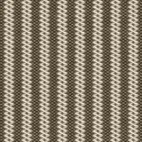](https://github.com/Artbyo3/DEVIL-PAINTER_Asset_Library/releases/tag/untagged-d4cbd3b167b5845abf0d) `cable-knit-16.png` [Shelf](https://github.com/Artbyo3/DEVIL-PAINTER_Asset_Library/releases/tag/untagged-d4cbd3b167b5845abf0d) · [Public](https://github.com/Artbyo3/DEVIL-PAINTER_Asset_Library/releases/download/cloth-textures-vol2-v1.0.0/cable-knit-16.png) |
|  `cable-knit-17.png` [Shelf](https://github.com/Artbyo3/DEVIL-PAINTER_Asset_Library/releases/tag/untagged-d4cbd3b167b5845abf0d) · [Public](https://github.com/Artbyo3/DEVIL-PAINTER_Asset_Library/releases/download/cloth-textures-vol2-v1.0.0/cable-knit-17.png) |  `cable-knit-18.png` [Shelf](https://github.com/Artbyo3/DEVIL-PAINTER_Asset_Library/releases/tag/untagged-d4cbd3b167b5845abf0d) · [Public](https://github.com/Artbyo3/DEVIL-PAINTER_Asset_Library/releases/download/cloth-textures-vol2-v1.0.0/cable-knit-18.png) |  `jersey-knit-01.png` [Shelf](https://github.com/Artbyo3/DEVIL-PAINTER_Asset_Library/releases/tag/untagged-d4cbd3b167b5845abf0d) · [Public](https://github.com/Artbyo3/DEVIL-PAINTER_Asset_Library/releases/download/cloth-textures-vol2-v1.0.0/jersey-knit-01.png) | [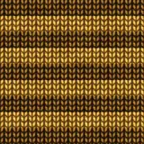](https://github.com/Artbyo3/DEVIL-PAINTER_Asset_Library/releases/tag/untagged-d4cbd3b167b5845abf0d) `jersey-knit-02.png` [Shelf](https://github.com/Artbyo3/DEVIL-PAINTER_Asset_Library/releases/tag/untagged-d4cbd3b167b5845abf0d) · [Public](https://github.com/Artbyo3/DEVIL-PAINTER_Asset_Library/releases/download/cloth-textures-vol2-v1.0.0/jersey-knit-02.png) |
|  `jersey-knit-03.png` [Shelf](https://github.com/Artbyo3/DEVIL-PAINTER_Asset_Library/releases/tag/untagged-d4cbd3b167b5845abf0d) · [Public](https://github.com/Artbyo3/DEVIL-PAINTER_Asset_Library/releases/download/cloth-textures-vol2-v1.0.0/jersey-knit-03.png) |  `jersey-knit-04.png` [Shelf](https://github.com/Artbyo3/DEVIL-PAINTER_Asset_Library/releases/tag/untagged-d4cbd3b167b5845abf0d) · [Public](https://github.com/Artbyo3/DEVIL-PAINTER_Asset_Library/releases/download/cloth-textures-vol2-v1.0.0/jersey-knit-04.png) |  `jersey-knit-05.png` [Shelf](https://github.com/Artbyo3/DEVIL-PAINTER_Asset_Library/releases/tag/untagged-d4cbd3b167b5845abf0d) · [Public](https://github.com/Artbyo3/DEVIL-PAINTER_Asset_Library/releases/download/cloth-textures-vol2-v1.0.0/jersey-knit-05.png) | [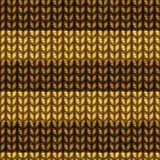](https://github.com/Artbyo3/DEVIL-PAINTER_Asset_Library/releases/tag/untagged-d4cbd3b167b5845abf0d) `jersey-knit-06.png` [Shelf](https://github.com/Artbyo3/DEVIL-PAINTER_Asset_Library/releases/tag/untagged-d4cbd3b167b5845abf0d) · [Public](https://github.com/Artbyo3/DEVIL-PAINTER_Asset_Library/releases/download/cloth-textures-vol2-v1.0.0/jersey-knit-06.png) |
| [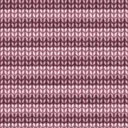](https://github.com/Artbyo3/DEVIL-PAINTER_Asset_Library/releases/tag/untagged-d4cbd3b167b5845abf0d) `jersey-knit-07.png` [Shelf](https://github.com/Artbyo3/DEVIL-PAINTER_Asset_Library/releases/tag/untagged-d4cbd3b167b5845abf0d) · [Public](https://github.com/Artbyo3/DEVIL-PAINTER_Asset_Library/releases/download/cloth-textures-vol2-v1.0.0/jersey-knit-07.png) | [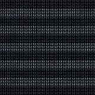](https://github.com/Artbyo3/DEVIL-PAINTER_Asset_Library/releases/tag/untagged-d4cbd3b167b5845abf0d) `jersey-knit-08.png` [Shelf](https://github.com/Artbyo3/DEVIL-PAINTER_Asset_Library/releases/tag/untagged-d4cbd3b167b5845abf0d) · [Public](https://github.com/Artbyo3/DEVIL-PAINTER_Asset_Library/releases/download/cloth-textures-vol2-v1.0.0/jersey-knit-08.png) |  `jersey-knit-09.png` [Shelf](https://github.com/Artbyo3/DEVIL-PAINTER_Asset_Library/releases/tag/untagged-d4cbd3b167b5845abf0d) · [Public](https://github.com/Artbyo3/DEVIL-PAINTER_Asset_Library/releases/download/cloth-textures-vol2-v1.0.0/jersey-knit-09.png) | [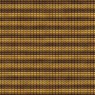](https://github.com/Artbyo3/DEVIL-PAINTER_Asset_Library/releases/tag/untagged-d4cbd3b167b5845abf0d) `jersey-knit-10.png` [Shelf](https://github.com/Artbyo3/DEVIL-PAINTER_Asset_Library/releases/tag/untagged-d4cbd3b167b5845abf0d) · [Public](https://github.com/Artbyo3/DEVIL-PAINTER_Asset_Library/releases/download/cloth-textures-vol2-v1.0.0/jersey-knit-10.png) |
| [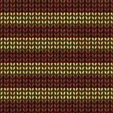](https://github.com/Artbyo3/DEVIL-PAINTER_Asset_Library/releases/tag/untagged-d4cbd3b167b5845abf0d) `jersey-knit-11.png` [Shelf](https://github.com/Artbyo3/DEVIL-PAINTER_Asset_Library/releases/tag/untagged-d4cbd3b167b5845abf0d) · [Public](https://github.com/Artbyo3/DEVIL-PAINTER_Asset_Library/releases/download/cloth-textures-vol2-v1.0.0/jersey-knit-11.png) |  `jersey-knit-12.png` [Shelf](https://github.com/Artbyo3/DEVIL-PAINTER_Asset_Library/releases/tag/untagged-d4cbd3b167b5845abf0d) · [Public](https://github.com/Artbyo3/DEVIL-PAINTER_Asset_Library/releases/download/cloth-textures-vol2-v1.0.0/jersey-knit-12.png) |  `jersey-knit-13.png` [Shelf](https://github.com/Artbyo3/DEVIL-PAINTER_Asset_Library/releases/tag/untagged-d4cbd3b167b5845abf0d) · [Public](https://github.com/Artbyo3/DEVIL-PAINTER_Asset_Library/releases/download/cloth-textures-vol2-v1.0.0/jersey-knit-13.png) |  `jersey-knit-14.png` [Shelf](https://github.com/Artbyo3/DEVIL-PAINTER_Asset_Library/releases/tag/untagged-d4cbd3b167b5845abf0d) · [Public](https://github.com/Artbyo3/DEVIL-PAINTER_Asset_Library/releases/download/cloth-textures-vol2-v1.0.0/jersey-knit-14.png) |
|  `jersey-knit-15.png` [Shelf](https://github.com/Artbyo3/DEVIL-PAINTER_Asset_Library/releases/tag/untagged-d4cbd3b167b5845abf0d) · [Public](https://github.com/Artbyo3/DEVIL-PAINTER_Asset_Library/releases/download/cloth-textures-vol2-v1.0.0/jersey-knit-15.png) |  `jersey-knit-16.png` [Shelf](https://github.com/Artbyo3/DEVIL-PAINTER_Asset_Library/releases/tag/untagged-d4cbd3b167b5845abf0d) · [Public](https://github.com/Artbyo3/DEVIL-PAINTER_Asset_Library/releases/download/cloth-textures-vol2-v1.0.0/jersey-knit-16.png) |  `jersey-knit-17.png` [Shelf](https://github.com/Artbyo3/DEVIL-PAINTER_Asset_Library/releases/tag/untagged-d4cbd3b167b5845abf0d) · [Public](https://github.com/Artbyo3/DEVIL-PAINTER_Asset_Library/releases/download/cloth-textures-vol2-v1.0.0/jersey-knit-17.png) |  `jersey-knit-18.png` [Shelf](https://github.com/Artbyo3/DEVIL-PAINTER_Asset_Library/releases/tag/untagged-d4cbd3b167b5845abf0d) · [Public](https://github.com/Artbyo3/DEVIL-PAINTER_Asset_Library/releases/download/cloth-textures-vol2-v1.0.0/jersey-knit-18.png) |
| [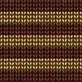](https://github.com/Artbyo3/DEVIL-PAINTER_Asset_Library/releases/tag/untagged-d4cbd3b167b5845abf0d) `jersey-knit-19.png` [Shelf](https://github.com/Artbyo3/DEVIL-PAINTER_Asset_Library/releases/tag/untagged-d4cbd3b167b5845abf0d) · [Public](https://github.com/Artbyo3/DEVIL-PAINTER_Asset_Library/releases/download/cloth-textures-vol2-v1.0.0/jersey-knit-19.png) |  `jersey-knit-20.png` [Shelf](https://github.com/Artbyo3/DEVIL-PAINTER_Asset_Library/releases/tag/untagged-d4cbd3b167b5845abf0d) · [Public](https://github.com/Artbyo3/DEVIL-PAINTER_Asset_Library/releases/download/cloth-textures-vol2-v1.0.0/jersey-knit-20.png) |  `jersey-knit-21.png` [Shelf](https://github.com/Artbyo3/DEVIL-PAINTER_Asset_Library/releases/tag/untagged-d4cbd3b167b5845abf0d) · [Public](https://github.com/Artbyo3/DEVIL-PAINTER_Asset_Library/releases/download/cloth-textures-vol2-v1.0.0/jersey-knit-21.png) | [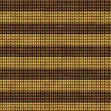](https://github.com/Artbyo3/DEVIL-PAINTER_Asset_Library/releases/tag/untagged-d4cbd3b167b5845abf0d) `jersey-knit-22.png` [Shelf](https://github.com/Artbyo3/DEVIL-PAINTER_Asset_Library/releases/tag/untagged-d4cbd3b167b5845abf0d) · [Public](https://github.com/Artbyo3/DEVIL-PAINTER_Asset_Library/releases/download/cloth-textures-vol2-v1.0.0/jersey-knit-22.png) |
| [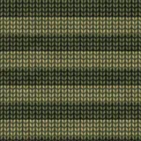](https://github.com/Artbyo3/DEVIL-PAINTER_Asset_Library/releases/tag/untagged-d4cbd3b167b5845abf0d) `jersey-knit-23.png` [Shelf](https://github.com/Artbyo3/DEVIL-PAINTER_Asset_Library/releases/tag/untagged-d4cbd3b167b5845abf0d) · [Public](https://github.com/Artbyo3/DEVIL-PAINTER_Asset_Library/releases/download/cloth-textures-vol2-v1.0.0/jersey-knit-23.png) | [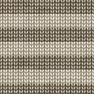](https://github.com/Artbyo3/DEVIL-PAINTER_Asset_Library/releases/tag/untagged-d4cbd3b167b5845abf0d) `jersey-knit-24.png` [Shelf](https://github.com/Artbyo3/DEVIL-PAINTER_Asset_Library/releases/tag/untagged-d4cbd3b167b5845abf0d) · [Public](https://github.com/Artbyo3/DEVIL-PAINTER_Asset_Library/releases/download/cloth-textures-vol2-v1.0.0/jersey-knit-24.png) |  `quilted-puffer-01.png` [Shelf](https://github.com/Artbyo3/DEVIL-PAINTER_Asset_Library/releases/tag/untagged-d4cbd3b167b5845abf0d) · [Public](https://github.com/Artbyo3/DEVIL-PAINTER_Asset_Library/releases/download/cloth-textures-vol2-v1.0.0/quilted-puffer-01.png) |  `quilted-puffer-02.png` [Shelf](https://github.com/Artbyo3/DEVIL-PAINTER_Asset_Library/releases/tag/untagged-d4cbd3b167b5845abf0d) · [Public](https://github.com/Artbyo3/DEVIL-PAINTER_Asset_Library/releases/download/cloth-textures-vol2-v1.0.0/quilted-puffer-02.png) |
| [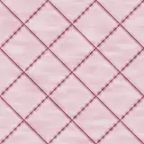](https://github.com/Artbyo3/DEVIL-PAINTER_Asset_Library/releases/tag/untagged-d4cbd3b167b5845abf0d) `quilted-puffer-03.png` [Shelf](https://github.com/Artbyo3/DEVIL-PAINTER_Asset_Library/releases/tag/untagged-d4cbd3b167b5845abf0d) · [Public](https://github.com/Artbyo3/DEVIL-PAINTER_Asset_Library/releases/download/cloth-textures-vol2-v1.0.0/quilted-puffer-03.png) |  `quilted-puffer-04.png` [Shelf](https://github.com/Artbyo3/DEVIL-PAINTER_Asset_Library/releases/tag/untagged-d4cbd3b167b5845abf0d) · [Public](https://github.com/Artbyo3/DEVIL-PAINTER_Asset_Library/releases/download/cloth-textures-vol2-v1.0.0/quilted-puffer-04.png) |  `quilted-puffer-05.png` [Shelf](https://github.com/Artbyo3/DEVIL-PAINTER_Asset_Library/releases/tag/untagged-d4cbd3b167b5845abf0d) · [Public](https://github.com/Artbyo3/DEVIL-PAINTER_Asset_Library/releases/download/cloth-textures-vol2-v1.0.0/quilted-puffer-05.png) | [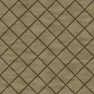](https://github.com/Artbyo3/DEVIL-PAINTER_Asset_Library/releases/tag/untagged-d4cbd3b167b5845abf0d) `quilted-puffer-06.png` [Shelf](https://github.com/Artbyo3/DEVIL-PAINTER_Asset_Library/releases/tag/untagged-d4cbd3b167b5845abf0d) · [Public](https://github.com/Artbyo3/DEVIL-PAINTER_Asset_Library/releases/download/cloth-textures-vol2-v1.0.0/quilted-puffer-06.png) |
|  `quilted-puffer-07.png` [Shelf](https://github.com/Artbyo3/DEVIL-PAINTER_Asset_Library/releases/tag/untagged-d4cbd3b167b5845abf0d) · [Public](https://github.com/Artbyo3/DEVIL-PAINTER_Asset_Library/releases/download/cloth-textures-vol2-v1.0.0/quilted-puffer-07.png) |  `quilted-puffer-08.png` [Shelf](https://github.com/Artbyo3/DEVIL-PAINTER_Asset_Library/releases/tag/untagged-d4cbd3b167b5845abf0d) · [Public](https://github.com/Artbyo3/DEVIL-PAINTER_Asset_Library/releases/download/cloth-textures-vol2-v1.0.0/quilted-puffer-08.png) | [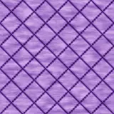](https://github.com/Artbyo3/DEVIL-PAINTER_Asset_Library/releases/tag/untagged-d4cbd3b167b5845abf0d) `quilted-puffer-09.png` [Shelf](https://github.com/Artbyo3/DEVIL-PAINTER_Asset_Library/releases/tag/untagged-d4cbd3b167b5845abf0d) · [Public](https://github.com/Artbyo3/DEVIL-PAINTER_Asset_Library/releases/download/cloth-textures-vol2-v1.0.0/quilted-puffer-09.png) | [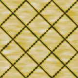](https://github.com/Artbyo3/DEVIL-PAINTER_Asset_Library/releases/tag/untagged-d4cbd3b167b5845abf0d) `quilted-puffer-10.png` [Shelf](https://github.com/Artbyo3/DEVIL-PAINTER_Asset_Library/releases/tag/untagged-d4cbd3b167b5845abf0d) · [Public](https://github.com/Artbyo3/DEVIL-PAINTER_Asset_Library/releases/download/cloth-textures-vol2-v1.0.0/quilted-puffer-10.png) |
|  `quilted-puffer-11.png` [Shelf](https://github.com/Artbyo3/DEVIL-PAINTER_Asset_Library/releases/tag/untagged-d4cbd3b167b5845abf0d) · [Public](https://github.com/Artbyo3/DEVIL-PAINTER_Asset_Library/releases/download/cloth-textures-vol2-v1.0.0/quilted-puffer-11.png) |  `quilted-puffer-12.png` [Shelf](https://github.com/Artbyo3/DEVIL-PAINTER_Asset_Library/releases/tag/untagged-d4cbd3b167b5845abf0d) · [Public](https://github.com/Artbyo3/DEVIL-PAINTER_Asset_Library/releases/download/cloth-textures-vol2-v1.0.0/quilted-puffer-12.png) | [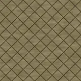](https://github.com/Artbyo3/DEVIL-PAINTER_Asset_Library/releases/tag/untagged-d4cbd3b167b5845abf0d) `quilted-puffer-13.png` [Shelf](https://github.com/Artbyo3/DEVIL-PAINTER_Asset_Library/releases/tag/untagged-d4cbd3b167b5845abf0d) · [Public](https://github.com/Artbyo3/DEVIL-PAINTER_Asset_Library/releases/download/cloth-textures-vol2-v1.0.0/quilted-puffer-13.png) |  `quilted-puffer-14.png` [Shelf](https://github.com/Artbyo3/DEVIL-PAINTER_Asset_Library/releases/tag/untagged-d4cbd3b167b5845abf0d) · [Public](https://github.com/Artbyo3/DEVIL-PAINTER_Asset_Library/releases/download/cloth-textures-vol2-v1.0.0/quilted-puffer-14.png) |
| [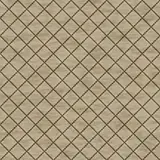](https://github.com/Artbyo3/DEVIL-PAINTER_Asset_Library/releases/tag/untagged-d4cbd3b167b5845abf0d) `quilted-puffer-15.png` [Shelf](https://github.com/Artbyo3/DEVIL-PAINTER_Asset_Library/releases/tag/untagged-d4cbd3b167b5845abf0d) · [Public](https://github.com/Artbyo3/DEVIL-PAINTER_Asset_Library/releases/download/cloth-textures-vol2-v1.0.0/quilted-puffer-15.png) |  `quilted-puffer-16.png` [Shelf](https://github.com/Artbyo3/DEVIL-PAINTER_Asset_Library/releases/tag/untagged-d4cbd3b167b5845abf0d) · [Public](https://github.com/Artbyo3/DEVIL-PAINTER_Asset_Library/releases/download/cloth-textures-vol2-v1.0.0/quilted-puffer-16.png) |  `quilted-puffer-17.png` [Shelf](https://github.com/Artbyo3/DEVIL-PAINTER_Asset_Library/releases/tag/untagged-d4cbd3b167b5845abf0d) · [Public](https://github.com/Artbyo3/DEVIL-PAINTER_Asset_Library/releases/download/cloth-textures-vol2-v1.0.0/quilted-puffer-17.png) | [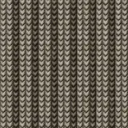](https://github.com/Artbyo3/DEVIL-PAINTER_Asset_Library/releases/tag/untagged-d4cbd3b167b5845abf0d) `rib-jersey-knit-01.png` [Shelf](https://github.com/Artbyo3/DEVIL-PAINTER_Asset_Library/releases/tag/untagged-d4cbd3b167b5845abf0d) · [Public](https://github.com/Artbyo3/DEVIL-PAINTER_Asset_Library/releases/download/cloth-textures-vol2-v1.0.0/rib-jersey-knit-01.png) |
|  `rib-jersey-knit-02.png` [Shelf](https://github.com/Artbyo3/DEVIL-PAINTER_Asset_Library/releases/tag/untagged-d4cbd3b167b5845abf0d) · [Public](https://github.com/Artbyo3/DEVIL-PAINTER_Asset_Library/releases/download/cloth-textures-vol2-v1.0.0/rib-jersey-knit-02.png) |  `rib-jersey-knit-03.png` [Shelf](https://github.com/Artbyo3/DEVIL-PAINTER_Asset_Library/releases/tag/untagged-d4cbd3b167b5845abf0d) · [Public](https://github.com/Artbyo3/DEVIL-PAINTER_Asset_Library/releases/download/cloth-textures-vol2-v1.0.0/rib-jersey-knit-03.png) | [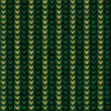](https://github.com/Artbyo3/DEVIL-PAINTER_Asset_Library/releases/tag/untagged-d4cbd3b167b5845abf0d) `rib-jersey-knit-04.png` [Shelf](https://github.com/Artbyo3/DEVIL-PAINTER_Asset_Library/releases/tag/untagged-d4cbd3b167b5845abf0d) · [Public](https://github.com/Artbyo3/DEVIL-PAINTER_Asset_Library/releases/download/cloth-textures-vol2-v1.0.0/rib-jersey-knit-04.png) |  `rib-jersey-knit-05.png` [Shelf](https://github.com/Artbyo3/DEVIL-PAINTER_Asset_Library/releases/tag/untagged-d4cbd3b167b5845abf0d) · [Public](https://github.com/Artbyo3/DEVIL-PAINTER_Asset_Library/releases/download/cloth-textures-vol2-v1.0.0/rib-jersey-knit-05.png) |
| [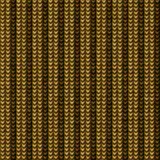](https://github.com/Artbyo3/DEVIL-PAINTER_Asset_Library/releases/tag/untagged-d4cbd3b167b5845abf0d) `rib-jersey-knit-06.png` [Shelf](https://github.com/Artbyo3/DEVIL-PAINTER_Asset_Library/releases/tag/untagged-d4cbd3b167b5845abf0d) · [Public](https://github.com/Artbyo3/DEVIL-PAINTER_Asset_Library/releases/download/cloth-textures-vol2-v1.0.0/rib-jersey-knit-06.png) | [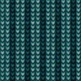](https://github.com/Artbyo3/DEVIL-PAINTER_Asset_Library/releases/tag/untagged-d4cbd3b167b5845abf0d) `rib-jersey-knit-07.png` [Shelf](https://github.com/Artbyo3/DEVIL-PAINTER_Asset_Library/releases/tag/untagged-d4cbd3b167b5845abf0d) · [Public](https://github.com/Artbyo3/DEVIL-PAINTER_Asset_Library/releases/download/cloth-textures-vol2-v1.0.0/rib-jersey-knit-07.png) |  `rib-jersey-knit-08.png` [Shelf](https://github.com/Artbyo3/DEVIL-PAINTER_Asset_Library/releases/tag/untagged-d4cbd3b167b5845abf0d) · [Public](https://github.com/Artbyo3/DEVIL-PAINTER_Asset_Library/releases/download/cloth-textures-vol2-v1.0.0/rib-jersey-knit-08.png) |  `rib-jersey-knit-09.png` [Shelf](https://github.com/Artbyo3/DEVIL-PAINTER_Asset_Library/releases/tag/untagged-d4cbd3b167b5845abf0d) · [Public](https://github.com/Artbyo3/DEVIL-PAINTER_Asset_Library/releases/download/cloth-textures-vol2-v1.0.0/rib-jersey-knit-09.png) |
|  `rib-jersey-knit-10.png` [Shelf](https://github.com/Artbyo3/DEVIL-PAINTER_Asset_Library/releases/tag/untagged-d4cbd3b167b5845abf0d) · [Public](https://github.com/Artbyo3/DEVIL-PAINTER_Asset_Library/releases/download/cloth-textures-vol2-v1.0.0/rib-jersey-knit-10.png) |  `rib-jersey-knit-11.png` [Shelf](https://github.com/Artbyo3/DEVIL-PAINTER_Asset_Library/releases/tag/untagged-d4cbd3b167b5845abf0d) · [Public](https://github.com/Artbyo3/DEVIL-PAINTER_Asset_Library/releases/download/cloth-textures-vol2-v1.0.0/rib-jersey-knit-11.png) | [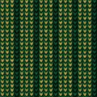](https://github.com/Artbyo3/DEVIL-PAINTER_Asset_Library/releases/tag/untagged-d4cbd3b167b5845abf0d) `rib-jersey-knit-12.png` [Shelf](https://github.com/Artbyo3/DEVIL-PAINTER_Asset_Library/releases/tag/untagged-d4cbd3b167b5845abf0d) · [Public](https://github.com/Artbyo3/DEVIL-PAINTER_Asset_Library/releases/download/cloth-textures-vol2-v1.0.0/rib-jersey-knit-12.png) |  `rib-jersey-knit-13.png` [Shelf](https://github.com/Artbyo3/DEVIL-PAINTER_Asset_Library/releases/tag/untagged-d4cbd3b167b5845abf0d) · [Public](https://github.com/Artbyo3/DEVIL-PAINTER_Asset_Library/releases/download/cloth-textures-vol2-v1.0.0/rib-jersey-knit-13.png) |
|  `rib-jersey-knit-14.png` [Shelf](https://github.com/Artbyo3/DEVIL-PAINTER_Asset_Library/releases/tag/untagged-d4cbd3b167b5845abf0d) · [Public](https://github.com/Artbyo3/DEVIL-PAINTER_Asset_Library/releases/download/cloth-textures-vol2-v1.0.0/rib-jersey-knit-14.png) | [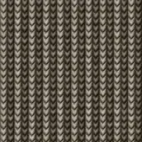](https://github.com/Artbyo3/DEVIL-PAINTER_Asset_Library/releases/tag/untagged-d4cbd3b167b5845abf0d) `rib-jersey-knit-15.png` [Shelf](https://github.com/Artbyo3/DEVIL-PAINTER_Asset_Library/releases/tag/untagged-d4cbd3b167b5845abf0d) · [Public](https://github.com/Artbyo3/DEVIL-PAINTER_Asset_Library/releases/download/cloth-textures-vol2-v1.0.0/rib-jersey-knit-15.png) |  `rib-jersey-knit-16.png` [Shelf](https://github.com/Artbyo3/DEVIL-PAINTER_Asset_Library/releases/tag/untagged-d4cbd3b167b5845abf0d) · [Public](https://github.com/Artbyo3/DEVIL-PAINTER_Asset_Library/releases/download/cloth-textures-vol2-v1.0.0/rib-jersey-knit-16.png) |  `rib-jersey-knit-17.png` [Shelf](https://github.com/Artbyo3/DEVIL-PAINTER_Asset_Library/releases/tag/untagged-d4cbd3b167b5845abf0d) · [Public](https://github.com/Artbyo3/DEVIL-PAINTER_Asset_Library/releases/download/cloth-textures-vol2-v1.0.0/rib-jersey-knit-17.png) |
| [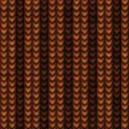](https://github.com/Artbyo3/DEVIL-PAINTER_Asset_Library/releases/tag/untagged-d4cbd3b167b5845abf0d) `rib-jersey-knit-18.png` [Shelf](https://github.com/Artbyo3/DEVIL-PAINTER_Asset_Library/releases/tag/untagged-d4cbd3b167b5845abf0d) · [Public](https://github.com/Artbyo3/DEVIL-PAINTER_Asset_Library/releases/download/cloth-textures-vol2-v1.0.0/rib-jersey-knit-18.png) | [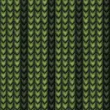](https://github.com/Artbyo3/DEVIL-PAINTER_Asset_Library/releases/tag/untagged-d4cbd3b167b5845abf0d) `rib-jersey-knit-19.png` [Shelf](https://github.com/Artbyo3/DEVIL-PAINTER_Asset_Library/releases/tag/untagged-d4cbd3b167b5845abf0d) · [Public](https://github.com/Artbyo3/DEVIL-PAINTER_Asset_Library/releases/download/cloth-textures-vol2-v1.0.0/rib-jersey-knit-19.png) |  `rib-jersey-knit-20.png` [Shelf](https://github.com/Artbyo3/DEVIL-PAINTER_Asset_Library/releases/tag/untagged-d4cbd3b167b5845abf0d) · [Public](https://github.com/Artbyo3/DEVIL-PAINTER_Asset_Library/releases/download/cloth-textures-vol2-v1.0.0/rib-jersey-knit-20.png) |  `rib-jersey-knit-21.png` [Shelf](https://github.com/Artbyo3/DEVIL-PAINTER_Asset_Library/releases/tag/untagged-d4cbd3b167b5845abf0d) · [Public](https://github.com/Artbyo3/DEVIL-PAINTER_Asset_Library/releases/download/cloth-textures-vol2-v1.0.0/rib-jersey-knit-21.png) |
| [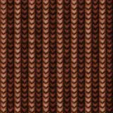](https://github.com/Artbyo3/DEVIL-PAINTER_Asset_Library/releases/tag/untagged-d4cbd3b167b5845abf0d) `rib-jersey-knit-22.png` [Shelf](https://github.com/Artbyo3/DEVIL-PAINTER_Asset_Library/releases/tag/untagged-d4cbd3b167b5845abf0d) · [Public](https://github.com/Artbyo3/DEVIL-PAINTER_Asset_Library/releases/download/cloth-textures-vol2-v1.0.0/rib-jersey-knit-22.png) | [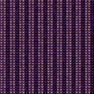](https://github.com/Artbyo3/DEVIL-PAINTER_Asset_Library/releases/tag/untagged-d4cbd3b167b5845abf0d) `rib-jersey-knit-23.png` [Shelf](https://github.com/Artbyo3/DEVIL-PAINTER_Asset_Library/releases/tag/untagged-d4cbd3b167b5845abf0d) · [Public](https://github.com/Artbyo3/DEVIL-PAINTER_Asset_Library/releases/download/cloth-textures-vol2-v1.0.0/rib-jersey-knit-23.png) | [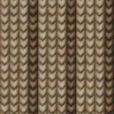](https://github.com/Artbyo3/DEVIL-PAINTER_Asset_Library/releases/tag/untagged-d4cbd3b167b5845abf0d) `rib-jersey-knit-24.png` [Shelf](https://github.com/Artbyo3/DEVIL-PAINTER_Asset_Library/releases/tag/untagged-d4cbd3b167b5845abf0d) · [Public](https://github.com/Artbyo3/DEVIL-PAINTER_Asset_Library/releases/download/cloth-textures-vol2-v1.0.0/rib-jersey-knit-24.png) | [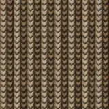](https://github.com/Artbyo3/DEVIL-PAINTER_Asset_Library/releases/tag/untagged-d4cbd3b167b5845abf0d) `rib-jersey-knit-25.png` [Shelf](https://github.com/Artbyo3/DEVIL-PAINTER_Asset_Library/releases/tag/untagged-d4cbd3b167b5845abf0d) · [Public](https://github.com/Artbyo3/DEVIL-PAINTER_Asset_Library/releases/download/cloth-textures-vol2-v1.0.0/rib-jersey-knit-25.png) |
|  `rib-jersey-knit-26.png` [Shelf](https://github.com/Artbyo3/DEVIL-PAINTER_Asset_Library/releases/tag/untagged-d4cbd3b167b5845abf0d) · [Public](https://github.com/Artbyo3/DEVIL-PAINTER_Asset_Library/releases/download/cloth-textures-vol2-v1.0.0/rib-jersey-knit-26.png) |  `rib-jersey-knit-27.png` [Shelf](https://github.com/Artbyo3/DEVIL-PAINTER_Asset_Library/releases/tag/untagged-d4cbd3b167b5845abf0d) · [Public](https://github.com/Artbyo3/DEVIL-PAINTER_Asset_Library/releases/download/cloth-textures-vol2-v1.0.0/rib-jersey-knit-27.png) | [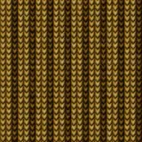](https://github.com/Artbyo3/DEVIL-PAINTER_Asset_Library/releases/tag/untagged-d4cbd3b167b5845abf0d) `rib-jersey-knit-28.png` [Shelf](https://github.com/Artbyo3/DEVIL-PAINTER_Asset_Library/releases/tag/untagged-d4cbd3b167b5845abf0d) · [Public](https://github.com/Artbyo3/DEVIL-PAINTER_Asset_Library/releases/download/cloth-textures-vol2-v1.0.0/rib-jersey-knit-28.png) | [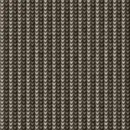](https://github.com/Artbyo3/DEVIL-PAINTER_Asset_Library/releases/tag/untagged-d4cbd3b167b5845abf0d) `rib-jersey-knit-29.png` [Shelf](https://github.com/Artbyo3/DEVIL-PAINTER_Asset_Library/releases/tag/untagged-d4cbd3b167b5845abf0d) · [Public](https://github.com/Artbyo3/DEVIL-PAINTER_Asset_Library/releases/download/cloth-textures-vol2-v1.0.0/rib-jersey-knit-29.png) |
|  `rib-jersey-knit-30.png` [Shelf](https://github.com/Artbyo3/DEVIL-PAINTER_Asset_Library/releases/tag/untagged-d4cbd3b167b5845abf0d) · [Public](https://github.com/Artbyo3/DEVIL-PAINTER_Asset_Library/releases/download/cloth-textures-vol2-v1.0.0/rib-jersey-knit-30.png) |  `rib-jersey-knit-31.png` [Shelf](https://github.com/Artbyo3/DEVIL-PAINTER_Asset_Library/releases/tag/untagged-d4cbd3b167b5845abf0d) · [Public](https://github.com/Artbyo3/DEVIL-PAINTER_Asset_Library/releases/download/cloth-textures-vol2-v1.0.0/rib-jersey-knit-31.png) | [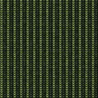](https://github.com/Artbyo3/DEVIL-PAINTER_Asset_Library/releases/tag/untagged-d4cbd3b167b5845abf0d) `rib-jersey-knit-32.png` [Shelf](https://github.com/Artbyo3/DEVIL-PAINTER_Asset_Library/releases/tag/untagged-d4cbd3b167b5845abf0d) · [Public](https://github.com/Artbyo3/DEVIL-PAINTER_Asset_Library/releases/download/cloth-textures-vol2-v1.0.0/rib-jersey-knit-32.png) | [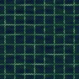](https://github.com/Artbyo3/DEVIL-PAINTER_Asset_Library/releases/tag/untagged-d4cbd3b167b5845abf0d) `ripstop-nylon-01.png` [Shelf](https://github.com/Artbyo3/DEVIL-PAINTER_Asset_Library/releases/tag/untagged-d4cbd3b167b5845abf0d) · [Public](https://github.com/Artbyo3/DEVIL-PAINTER_Asset_Library/releases/download/cloth-textures-vol2-v1.0.0/ripstop-nylon-01.png) |
| [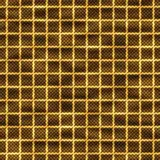](https://github.com/Artbyo3/DEVIL-PAINTER_Asset_Library/releases/tag/untagged-d4cbd3b167b5845abf0d) `ripstop-nylon-02.png` [Shelf](https://github.com/Artbyo3/DEVIL-PAINTER_Asset_Library/releases/tag/untagged-d4cbd3b167b5845abf0d) · [Public](https://github.com/Artbyo3/DEVIL-PAINTER_Asset_Library/releases/download/cloth-textures-vol2-v1.0.0/ripstop-nylon-02.png) | [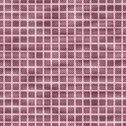](https://github.com/Artbyo3/DEVIL-PAINTER_Asset_Library/releases/tag/untagged-d4cbd3b167b5845abf0d) `ripstop-nylon-03.png` [Shelf](https://github.com/Artbyo3/DEVIL-PAINTER_Asset_Library/releases/tag/untagged-d4cbd3b167b5845abf0d) · [Public](https://github.com/Artbyo3/DEVIL-PAINTER_Asset_Library/releases/download/cloth-textures-vol2-v1.0.0/ripstop-nylon-03.png) |  `ripstop-nylon-04.png` [Shelf](https://github.com/Artbyo3/DEVIL-PAINTER_Asset_Library/releases/tag/untagged-d4cbd3b167b5845abf0d) · [Public](https://github.com/Artbyo3/DEVIL-PAINTER_Asset_Library/releases/download/cloth-textures-vol2-v1.0.0/ripstop-nylon-04.png) |  `ripstop-nylon-05.png` [Shelf](https://github.com/Artbyo3/DEVIL-PAINTER_Asset_Library/releases/tag/untagged-d4cbd3b167b5845abf0d) · [Public](https://github.com/Artbyo3/DEVIL-PAINTER_Asset_Library/releases/download/cloth-textures-vol2-v1.0.0/ripstop-nylon-05.png) |
| [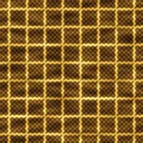](https://github.com/Artbyo3/DEVIL-PAINTER_Asset_Library/releases/tag/untagged-d4cbd3b167b5845abf0d) `ripstop-nylon-06.png` [Shelf](https://github.com/Artbyo3/DEVIL-PAINTER_Asset_Library/releases/tag/untagged-d4cbd3b167b5845abf0d) · [Public](https://github.com/Artbyo3/DEVIL-PAINTER_Asset_Library/releases/download/cloth-textures-vol2-v1.0.0/ripstop-nylon-06.png) | [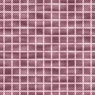](https://github.com/Artbyo3/DEVIL-PAINTER_Asset_Library/releases/tag/untagged-d4cbd3b167b5845abf0d) `ripstop-nylon-07.png` [Shelf](https://github.com/Artbyo3/DEVIL-PAINTER_Asset_Library/releases/tag/untagged-d4cbd3b167b5845abf0d) · [Public](https://github.com/Artbyo3/DEVIL-PAINTER_Asset_Library/releases/download/cloth-textures-vol2-v1.0.0/ripstop-nylon-07.png) |  `ripstop-nylon-08.png` [Shelf](https://github.com/Artbyo3/DEVIL-PAINTER_Asset_Library/releases/tag/untagged-d4cbd3b167b5845abf0d) · [Public](https://github.com/Artbyo3/DEVIL-PAINTER_Asset_Library/releases/download/cloth-textures-vol2-v1.0.0/ripstop-nylon-08.png) |  `ripstop-nylon-09.png` [Shelf](https://github.com/Artbyo3/DEVIL-PAINTER_Asset_Library/releases/tag/untagged-d4cbd3b167b5845abf0d) · [Public](https://github.com/Artbyo3/DEVIL-PAINTER_Asset_Library/releases/download/cloth-textures-vol2-v1.0.0/ripstop-nylon-09.png) |
| [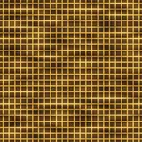](https://github.com/Artbyo3/DEVIL-PAINTER_Asset_Library/releases/tag/untagged-d4cbd3b167b5845abf0d) `ripstop-nylon-10.png` [Shelf](https://github.com/Artbyo3/DEVIL-PAINTER_Asset_Library/releases/tag/untagged-d4cbd3b167b5845abf0d) · [Public](https://github.com/Artbyo3/DEVIL-PAINTER_Asset_Library/releases/download/cloth-textures-vol2-v1.0.0/ripstop-nylon-10.png) |  `ripstop-nylon-11.png` [Shelf](https://github.com/Artbyo3/DEVIL-PAINTER_Asset_Library/releases/tag/untagged-d4cbd3b167b5845abf0d) · [Public](https://github.com/Artbyo3/DEVIL-PAINTER_Asset_Library/releases/download/cloth-textures-vol2-v1.0.0/ripstop-nylon-11.png) | [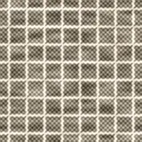](https://github.com/Artbyo3/DEVIL-PAINTER_Asset_Library/releases/tag/untagged-d4cbd3b167b5845abf0d) `ripstop-nylon-12.png` [Shelf](https://github.com/Artbyo3/DEVIL-PAINTER_Asset_Library/releases/tag/untagged-d4cbd3b167b5845abf0d) · [Public](https://github.com/Artbyo3/DEVIL-PAINTER_Asset_Library/releases/download/cloth-textures-vol2-v1.0.0/ripstop-nylon-12.png) | [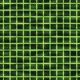](https://github.com/Artbyo3/DEVIL-PAINTER_Asset_Library/releases/tag/untagged-d4cbd3b167b5845abf0d) `ripstop-nylon-13.png` [Shelf](https://github.com/Artbyo3/DEVIL-PAINTER_Asset_Library/releases/tag/untagged-d4cbd3b167b5845abf0d) · [Public](https://github.com/Artbyo3/DEVIL-PAINTER_Asset_Library/releases/download/cloth-textures-vol2-v1.0.0/ripstop-nylon-13.png) |
|  `ripstop-nylon-14.png` [Shelf](https://github.com/Artbyo3/DEVIL-PAINTER_Asset_Library/releases/tag/untagged-d4cbd3b167b5845abf0d) · [Public](https://github.com/Artbyo3/DEVIL-PAINTER_Asset_Library/releases/download/cloth-textures-vol2-v1.0.0/ripstop-nylon-14.png) | [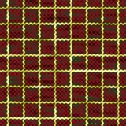](https://github.com/Artbyo3/DEVIL-PAINTER_Asset_Library/releases/tag/untagged-d4cbd3b167b5845abf0d) `ripstop-nylon-15.png` [Shelf](https://github.com/Artbyo3/DEVIL-PAINTER_Asset_Library/releases/tag/untagged-d4cbd3b167b5845abf0d) · [Public](https://github.com/Artbyo3/DEVIL-PAINTER_Asset_Library/releases/download/cloth-textures-vol2-v1.0.0/ripstop-nylon-15.png) | [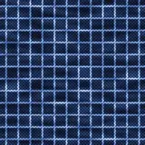](https://github.com/Artbyo3/DEVIL-PAINTER_Asset_Library/releases/tag/untagged-d4cbd3b167b5845abf0d) `ripstop-nylon-16.png` [Shelf](https://github.com/Artbyo3/DEVIL-PAINTER_Asset_Library/releases/tag/untagged-d4cbd3b167b5845abf0d) · [Public](https://github.com/Artbyo3/DEVIL-PAINTER_Asset_Library/releases/download/cloth-textures-vol2-v1.0.0/ripstop-nylon-16.png) | [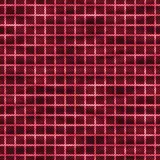](https://github.com/Artbyo3/DEVIL-PAINTER_Asset_Library/releases/tag/untagged-d4cbd3b167b5845abf0d) `ripstop-nylon-17.png` [Shelf](https://github.com/Artbyo3/DEVIL-PAINTER_Asset_Library/releases/tag/untagged-d4cbd3b167b5845abf0d) · [Public](https://github.com/Artbyo3/DEVIL-PAINTER_Asset_Library/releases/download/cloth-textures-vol2-v1.0.0/ripstop-nylon-17.png) |
|  `ripstop-nylon-18.png` [Shelf](https://github.com/Artbyo3/DEVIL-PAINTER_Asset_Library/releases/tag/untagged-d4cbd3b167b5845abf0d) · [Public](https://github.com/Artbyo3/DEVIL-PAINTER_Asset_Library/releases/download/cloth-textures-vol2-v1.0.0/ripstop-nylon-18.png) | [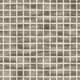](https://github.com/Artbyo3/DEVIL-PAINTER_Asset_Library/releases/tag/untagged-d4cbd3b167b5845abf0d) `ripstop-nylon-19.png` [Shelf](https://github.com/Artbyo3/DEVIL-PAINTER_Asset_Library/releases/tag/untagged-d4cbd3b167b5845abf0d) · [Public](https://github.com/Artbyo3/DEVIL-PAINTER_Asset_Library/releases/download/cloth-textures-vol2-v1.0.0/ripstop-nylon-19.png) | [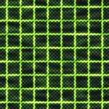](https://github.com/Artbyo3/DEVIL-PAINTER_Asset_Library/releases/tag/untagged-d4cbd3b167b5845abf0d) `ripstop-nylon-20.png` [Shelf](https://github.com/Artbyo3/DEVIL-PAINTER_Asset_Library/releases/tag/untagged-d4cbd3b167b5845abf0d) · [Public](https://github.com/Artbyo3/DEVIL-PAINTER_Asset_Library/releases/download/cloth-textures-vol2-v1.0.0/ripstop-nylon-20.png) |  `ripstop-nylon-21.png` [Shelf](https://github.com/Artbyo3/DEVIL-PAINTER_Asset_Library/releases/tag/untagged-d4cbd3b167b5845abf0d) · [Public](https://github.com/Artbyo3/DEVIL-PAINTER_Asset_Library/releases/download/cloth-textures-vol2-v1.0.0/ripstop-nylon-21.png) |
| [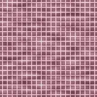](https://github.com/Artbyo3/DEVIL-PAINTER_Asset_Library/releases/tag/untagged-d4cbd3b167b5845abf0d) `ripstop-nylon-22.png` [Shelf](https://github.com/Artbyo3/DEVIL-PAINTER_Asset_Library/releases/tag/untagged-d4cbd3b167b5845abf0d) · [Public](https://github.com/Artbyo3/DEVIL-PAINTER_Asset_Library/releases/download/cloth-textures-vol2-v1.0.0/ripstop-nylon-22.png) | [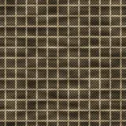](https://github.com/Artbyo3/DEVIL-PAINTER_Asset_Library/releases/tag/untagged-d4cbd3b167b5845abf0d) `ripstop-nylon-23.png` [Shelf](https://github.com/Artbyo3/DEVIL-PAINTER_Asset_Library/releases/tag/untagged-d4cbd3b167b5845abf0d) · [Public](https://github.com/Artbyo3/DEVIL-PAINTER_Asset_Library/releases/download/cloth-textures-vol2-v1.0.0/ripstop-nylon-23.png) | [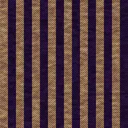](https://github.com/Artbyo3/DEVIL-PAINTER_Asset_Library/releases/tag/untagged-d4cbd3b167b5845abf0d) `seersucker-stripe-01.png` [Shelf](https://github.com/Artbyo3/DEVIL-PAINTER_Asset_Library/releases/tag/untagged-d4cbd3b167b5845abf0d) · [Public](https://github.com/Artbyo3/DEVIL-PAINTER_Asset_Library/releases/download/cloth-textures-vol2-v1.0.0/seersucker-stripe-01.png) | [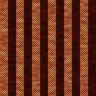](https://github.com/Artbyo3/DEVIL-PAINTER_Asset_Library/releases/tag/untagged-d4cbd3b167b5845abf0d) `seersucker-stripe-02.png` [Shelf](https://github.com/Artbyo3/DEVIL-PAINTER_Asset_Library/releases/tag/untagged-d4cbd3b167b5845abf0d) · [Public](https://github.com/Artbyo3/DEVIL-PAINTER_Asset_Library/releases/download/cloth-textures-vol2-v1.0.0/seersucker-stripe-02.png) |
|  `seersucker-stripe-03.png` [Shelf](https://github.com/Artbyo3/DEVIL-PAINTER_Asset_Library/releases/tag/untagged-d4cbd3b167b5845abf0d) · [Public](https://github.com/Artbyo3/DEVIL-PAINTER_Asset_Library/releases/download/cloth-textures-vol2-v1.0.0/seersucker-stripe-03.png) |  `seersucker-stripe-04.png` [Shelf](https://github.com/Artbyo3/DEVIL-PAINTER_Asset_Library/releases/tag/untagged-d4cbd3b167b5845abf0d) · [Public](https://github.com/Artbyo3/DEVIL-PAINTER_Asset_Library/releases/download/cloth-textures-vol2-v1.0.0/seersucker-stripe-04.png) |  `seersucker-stripe-05.png` [Shelf](https://github.com/Artbyo3/DEVIL-PAINTER_Asset_Library/releases/tag/untagged-d4cbd3b167b5845abf0d) · [Public](https://github.com/Artbyo3/DEVIL-PAINTER_Asset_Library/releases/download/cloth-textures-vol2-v1.0.0/seersucker-stripe-05.png) |  `seersucker-stripe-06.png` [Shelf](https://github.com/Artbyo3/DEVIL-PAINTER_Asset_Library/releases/tag/untagged-d4cbd3b167b5845abf0d) · [Public](https://github.com/Artbyo3/DEVIL-PAINTER_Asset_Library/releases/download/cloth-textures-vol2-v1.0.0/seersucker-stripe-06.png) |
|  `seersucker-stripe-07.png` [Shelf](https://github.com/Artbyo3/DEVIL-PAINTER_Asset_Library/releases/tag/untagged-d4cbd3b167b5845abf0d) · [Public](https://github.com/Artbyo3/DEVIL-PAINTER_Asset_Library/releases/download/cloth-textures-vol2-v1.0.0/seersucker-stripe-07.png) |  `seersucker-stripe-08.png` [Shelf](https://github.com/Artbyo3/DEVIL-PAINTER_Asset_Library/releases/tag/untagged-d4cbd3b167b5845abf0d) · [Public](https://github.com/Artbyo3/DEVIL-PAINTER_Asset_Library/releases/download/cloth-textures-vol2-v1.0.0/seersucker-stripe-08.png) |  `seersucker-stripe-09.png` [Shelf](https://github.com/Artbyo3/DEVIL-PAINTER_Asset_Library/releases/tag/untagged-d4cbd3b167b5845abf0d) · [Public](https://github.com/Artbyo3/DEVIL-PAINTER_Asset_Library/releases/download/cloth-textures-vol2-v1.0.0/seersucker-stripe-09.png) |  `seersucker-stripe-10.png` [Shelf](https://github.com/Artbyo3/DEVIL-PAINTER_Asset_Library/releases/tag/untagged-d4cbd3b167b5845abf0d) · [Public](https://github.com/Artbyo3/DEVIL-PAINTER_Asset_Library/releases/download/cloth-textures-vol2-v1.0.0/seersucker-stripe-10.png) |
|  `seersucker-stripe-11.png` [Shelf](https://github.com/Artbyo3/DEVIL-PAINTER_Asset_Library/releases/tag/untagged-d4cbd3b167b5845abf0d) · [Public](https://github.com/Artbyo3/DEVIL-PAINTER_Asset_Library/releases/download/cloth-textures-vol2-v1.0.0/seersucker-stripe-11.png) |  `seersucker-stripe-12.png` [Shelf](https://github.com/Artbyo3/DEVIL-PAINTER_Asset_Library/releases/tag/untagged-d4cbd3b167b5845abf0d) · [Public](https://github.com/Artbyo3/DEVIL-PAINTER_Asset_Library/releases/download/cloth-textures-vol2-v1.0.0/seersucker-stripe-12.png) |  `seersucker-stripe-13.png` [Shelf](https://github.com/Artbyo3/DEVIL-PAINTER_Asset_Library/releases/tag/untagged-d4cbd3b167b5845abf0d) · [Public](https://github.com/Artbyo3/DEVIL-PAINTER_Asset_Library/releases/download/cloth-textures-vol2-v1.0.0/seersucker-stripe-13.png) |  `shibori-tie-dye-01.png` [Shelf](https://github.com/Artbyo3/DEVIL-PAINTER_Asset_Library/releases/tag/untagged-d4cbd3b167b5845abf0d) · [Public](https://github.com/Artbyo3/DEVIL-PAINTER_Asset_Library/releases/download/cloth-textures-vol2-v1.0.0/shibori-tie-dye-01.png) |
|  `shibori-tie-dye-02.png` [Shelf](https://github.com/Artbyo3/DEVIL-PAINTER_Asset_Library/releases/tag/untagged-d4cbd3b167b5845abf0d) · [Public](https://github.com/Artbyo3/DEVIL-PAINTER_Asset_Library/releases/download/cloth-textures-vol2-v1.0.0/shibori-tie-dye-02.png) |  `shibori-tie-dye-03.png` [Shelf](https://github.com/Artbyo3/DEVIL-PAINTER_Asset_Library/releases/tag/untagged-d4cbd3b167b5845abf0d) · [Public](https://github.com/Artbyo3/DEVIL-PAINTER_Asset_Library/releases/download/cloth-textures-vol2-v1.0.0/shibori-tie-dye-03.png) |  `shibori-tie-dye-04.png` [Shelf](https://github.com/Artbyo3/DEVIL-PAINTER_Asset_Library/releases/tag/untagged-d4cbd3b167b5845abf0d) · [Public](https://github.com/Artbyo3/DEVIL-PAINTER_Asset_Library/releases/download/cloth-textures-vol2-v1.0.0/shibori-tie-dye-04.png) |  `shibori-tie-dye-05.png` [Shelf](https://github.com/Artbyo3/DEVIL-PAINTER_Asset_Library/releases/tag/untagged-d4cbd3b167b5845abf0d) · [Public](https://github.com/Artbyo3/DEVIL-PAINTER_Asset_Library/releases/download/cloth-textures-vol2-v1.0.0/shibori-tie-dye-05.png) |
|  `shibori-tie-dye-06.png` [Shelf](https://github.com/Artbyo3/DEVIL-PAINTER_Asset_Library/releases/tag/untagged-d4cbd3b167b5845abf0d) · [Public](https://github.com/Artbyo3/DEVIL-PAINTER_Asset_Library/releases/download/cloth-textures-vol2-v1.0.0/shibori-tie-dye-06.png) |  `shibori-tie-dye-07.png` [Shelf](https://github.com/Artbyo3/DEVIL-PAINTER_Asset_Library/releases/tag/untagged-d4cbd3b167b5845abf0d) · [Public](https://github.com/Artbyo3/DEVIL-PAINTER_Asset_Library/releases/download/cloth-textures-vol2-v1.0.0/shibori-tie-dye-07.png) |  `shibori-tie-dye-08.png` [Shelf](https://github.com/Artbyo3/DEVIL-PAINTER_Asset_Library/releases/tag/untagged-d4cbd3b167b5845abf0d) · [Public](https://github.com/Artbyo3/DEVIL-PAINTER_Asset_Library/releases/download/cloth-textures-vol2-v1.0.0/shibori-tie-dye-08.png) |  `shibori-tie-dye-09.png` [Shelf](https://github.com/Artbyo3/DEVIL-PAINTER_Asset_Library/releases/tag/untagged-d4cbd3b167b5845abf0d) · [Public](https://github.com/Artbyo3/DEVIL-PAINTER_Asset_Library/releases/download/cloth-textures-vol2-v1.0.0/shibori-tie-dye-09.png) |
|  `shibori-tie-dye-10.png` [Shelf](https://github.com/Artbyo3/DEVIL-PAINTER_Asset_Library/releases/tag/untagged-d4cbd3b167b5845abf0d) · [Public](https://github.com/Artbyo3/DEVIL-PAINTER_Asset_Library/releases/download/cloth-textures-vol2-v1.0.0/shibori-tie-dye-10.png) |  `shibori-tie-dye-11.png` [Shelf](https://github.com/Artbyo3/DEVIL-PAINTER_Asset_Library/releases/tag/untagged-d4cbd3b167b5845abf0d) · [Public](https://github.com/Artbyo3/DEVIL-PAINTER_Asset_Library/releases/download/cloth-textures-vol2-v1.0.0/shibori-tie-dye-11.png) |  `shibori-tie-dye-12.png` [Shelf](https://github.com/Artbyo3/DEVIL-PAINTER_Asset_Library/releases/tag/untagged-d4cbd3b167b5845abf0d) · [Public](https://github.com/Artbyo3/DEVIL-PAINTER_Asset_Library/releases/download/cloth-textures-vol2-v1.0.0/shibori-tie-dye-12.png) |  `shibori-tie-dye-13.png` [Shelf](https://github.com/Artbyo3/DEVIL-PAINTER_Asset_Library/releases/tag/untagged-d4cbd3b167b5845abf0d) · [Public](https://github.com/Artbyo3/DEVIL-PAINTER_Asset_Library/releases/download/cloth-textures-vol2-v1.0.0/shibori-tie-dye-13.png) |
|  `shibori-tie-dye-14.png` [Shelf](https://github.com/Artbyo3/DEVIL-PAINTER_Asset_Library/releases/tag/untagged-d4cbd3b167b5845abf0d) · [Public](https://github.com/Artbyo3/DEVIL-PAINTER_Asset_Library/releases/download/cloth-textures-vol2-v1.0.0/shibori-tie-dye-14.png) |  `waffle-knit-01.png` [Shelf](https://github.com/Artbyo3/DEVIL-PAINTER_Asset_Library/releases/tag/untagged-d4cbd3b167b5845abf0d) · [Public](https://github.com/Artbyo3/DEVIL-PAINTER_Asset_Library/releases/download/cloth-textures-vol2-v1.0.0/waffle-knit-01.png) |  `waffle-knit-02.png` [Shelf](https://github.com/Artbyo3/DEVIL-PAINTER_Asset_Library/releases/tag/untagged-d4cbd3b167b5845abf0d) · [Public](https://github.com/Artbyo3/DEVIL-PAINTER_Asset_Library/releases/download/cloth-textures-vol2-v1.0.0/waffle-knit-02.png) |  `waffle-knit-03.png` [Shelf](https://github.com/Artbyo3/DEVIL-PAINTER_Asset_Library/releases/tag/untagged-d4cbd3b167b5845abf0d) · [Public](https://github.com/Artbyo3/DEVIL-PAINTER_Asset_Library/releases/download/cloth-textures-vol2-v1.0.0/waffle-knit-03.png) |
|  `waffle-knit-04.png` [Shelf](https://github.com/Artbyo3/DEVIL-PAINTER_Asset_Library/releases/tag/untagged-d4cbd3b167b5845abf0d) · [Public](https://github.com/Artbyo3/DEVIL-PAINTER_Asset_Library/releases/download/cloth-textures-vol2-v1.0.0/waffle-knit-04.png) |  `waffle-knit-05.png` [Shelf](https://github.com/Artbyo3/DEVIL-PAINTER_Asset_Library/releases/tag/untagged-d4cbd3b167b5845abf0d) · [Public](https://github.com/Artbyo3/DEVIL-PAINTER_Asset_Library/releases/download/cloth-textures-vol2-v1.0.0/waffle-knit-05.png) |  `waffle-knit-06.png` [Shelf](https://github.com/Artbyo3/DEVIL-PAINTER_Asset_Library/releases/tag/untagged-d4cbd3b167b5845abf0d) · [Public](https://github.com/Artbyo3/DEVIL-PAINTER_Asset_Library/releases/download/cloth-textures-vol2-v1.0.0/waffle-knit-06.png) |  `waffle-knit-07.png` [Shelf](https://github.com/Artbyo3/DEVIL-PAINTER_Asset_Library/releases/tag/untagged-d4cbd3b167b5845abf0d) · [Public](https://github.com/Artbyo3/DEVIL-PAINTER_Asset_Library/releases/download/cloth-textures-vol2-v1.0.0/waffle-knit-07.png) |
|  `waffle-knit-08.png` [Shelf](https://github.com/Artbyo3/DEVIL-PAINTER_Asset_Library/releases/tag/untagged-d4cbd3b167b5845abf0d) · [Public](https://github.com/Artbyo3/DEVIL-PAINTER_Asset_Library/releases/download/cloth-textures-vol2-v1.0.0/waffle-knit-08.png) |  `waffle-knit-09.png` [Shelf](https://github.com/Artbyo3/DEVIL-PAINTER_Asset_Library/releases/tag/untagged-d4cbd3b167b5845abf0d) · [Public](https://github.com/Artbyo3/DEVIL-PAINTER_Asset_Library/releases/download/cloth-textures-vol2-v1.0.0/waffle-knit-09.png) |  `waffle-knit-10.png` [Shelf](https://github.com/Artbyo3/DEVIL-PAINTER_Asset_Library/releases/tag/untagged-d4cbd3b167b5845abf0d) · [Public](https://github.com/Artbyo3/DEVIL-PAINTER_Asset_Library/releases/download/cloth-textures-vol2-v1.0.0/waffle-knit-10.png) |  `waffle-knit-11.png` [Shelf](https://github.com/Artbyo3/DEVIL-PAINTER_Asset_Library/releases/tag/untagged-d4cbd3b167b5845abf0d) · [Public](https://github.com/Artbyo3/DEVIL-PAINTER_Asset_Library/releases/download/cloth-textures-vol2-v1.0.0/waffle-knit-11.png) |
|  `waffle-knit-12.png` [Shelf](https://github.com/Artbyo3/DEVIL-PAINTER_Asset_Library/releases/tag/untagged-d4cbd3b167b5845abf0d) · [Public](https://github.com/Artbyo3/DEVIL-PAINTER_Asset_Library/releases/download/cloth-textures-vol2-v1.0.0/waffle-knit-12.png) |  `waffle-knit-13.png` [Shelf](https://github.com/Artbyo3/DEVIL-PAINTER_Asset_Library/releases/tag/untagged-d4cbd3b167b5845abf0d) · [Public](https://github.com/Artbyo3/DEVIL-PAINTER_Asset_Library/releases/download/cloth-textures-vol2-v1.0.0/waffle-knit-13.png) |  `waffle-knit-14.png` [Shelf](https://github.com/Artbyo3/DEVIL-PAINTER_Asset_Library/releases/tag/untagged-d4cbd3b167b5845abf0d) · [Public](https://github.com/Artbyo3/DEVIL-PAINTER_Asset_Library/releases/download/cloth-textures-vol2-v1.0.0/waffle-knit-14.png) |  `waffle-knit-15.png` [Shelf](https://github.com/Artbyo3/DEVIL-PAINTER_Asset_Library/releases/tag/untagged-d4cbd3b167b5845abf0d) · [Public](https://github.com/Artbyo3/DEVIL-PAINTER_Asset_Library/releases/download/cloth-textures-vol2-v1.0.0/waffle-knit-15.png) |
|  `waffle-knit-16.png` [Shelf](https://github.com/Artbyo3/DEVIL-PAINTER_Asset_Library/releases/tag/untagged-d4cbd3b167b5845abf0d) · [Public](https://github.com/Artbyo3/DEVIL-PAINTER_Asset_Library/releases/download/cloth-textures-vol2-v1.0.0/waffle-knit-16.png) |  `waffle-knit-17.png` [Shelf](https://github.com/Artbyo3/DEVIL-PAINTER_Asset_Library/releases/tag/untagged-d4cbd3b167b5845abf0d) · [Public](https://github.com/Artbyo3/DEVIL-PAINTER_Asset_Library/releases/download/cloth-textures-vol2-v1.0.0/waffle-knit-17.png) |  `waffle-knit-18.png` [Shelf](https://github.com/Artbyo3/DEVIL-PAINTER_Asset_Library/releases/tag/untagged-d4cbd3b167b5845abf0d) · [Public](https://github.com/Artbyo3/DEVIL-PAINTER_Asset_Library/releases/download/cloth-textures-vol2-v1.0.0/waffle-knit-18.png) |  `waffle-knit-19.png` [Shelf](https://github.com/Artbyo3/DEVIL-PAINTER_Asset_Library/releases/tag/untagged-d4cbd3b167b5845abf0d) · [Public](https://github.com/Artbyo3/DEVIL-PAINTER_Asset_Library/releases/download/cloth-textures-vol2-v1.0.0/waffle-knit-19.png) |
